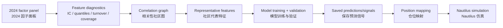

# 🔍 High-Resolution Feature Evaluation & Mapping / 高分辨率特征评价与仓位映射

## Executive Summary / 模块摘要

### Vectorized Feature Quality Assessment / 向量化特征质量评估

`feature_quality.py` is a local multiprocessed diagnostics engine for the **2024 in-sample research period**. It compares generated features through several complementary statistics; it does not, by itself, establish out-of-sample predictive power. A genuine OOS claim requires a later period that was not used for feature generation, direction selection, threshold tuning, or model validation.

`feature_quality.py` 是面向 **2024 年样本内研究期**的本地多进程诊断引擎。它通过多组互补指标比较生成特征，但这些结果本身不构成样本外预测力证明。真正的 OOS 结论需要使用一个未参与特征生成、方向选择、阈值调优或模型验证的后续时期。

Key diagnostics include (核心诊断指标包括):

*   **Period IC (2000-minute window)**: Computes IC over non-overlapping 2000-minute windows so that the evaluation unit is consistent across instruments with different daily session lengths. (使用 2000 分钟不重叠窗口计算 IC，使不同日内交易时长的品种采用一致的评价尺度)。
*   **Decile Return Spreads (Q10 - Q1)**: Buckets a feature into 10 quantiles to inspect monotonicity and the long-short return spread in addition to linear correlation. (将特征分为 10 组，在相关系数之外检查单调性与多空收益差)。
*   **Vectorized Simulation Metrics (向量化简易回测指标)**: The NumPy-based diagnostic simulation reports annualized return in bps, Sharpe ratio, and turnover under the script's stated assumptions. (基于 NumPy 的诊断性模拟在脚本所列假设下输出年化收益 bps、夏普比率与换手率)。

### AlphaMiner Pro Dashboard / 交互式特征分析看板

`dashboard_app.py` provides a Streamlit interface for reviewing the metrics exported by `feature_quality.py`. / `dashboard_app.py` 使用 Streamlit 展示 `feature_quality.py` 导出的评测结果。

*   **Feature-Centric View (单特征下钻视图)**: Shows decile-return charts, cross-instrument IC distributions, and H1-versus-H2 distribution shifts for a selected feature. (展示指定特征的分位数收益、跨品种 IC 分布及上下半年分布变化)。
*   **Scope-Centric View (全局横向视图)**: Ranks generated features by selected metrics within the chosen commodity or index pool and supports threshold filtering. (在选定的商品或指数品种池内按指标比较特征，并支持阈值筛选)。

### Graph-Based Feature Selection / 基于图网络的特征正交与分层初筛

Before model training, `select_feature.py` uses a correlation network and hierarchical voting to reduce redundancy and retain representative candidates. / 在模型训练前，`select_feature.py` 使用相关性网络与分层投票降低冗余，并保留具有代表性的候选特征。

*   **Hierarchical Community Discovery & Voting (社区发现与分层投票筛选)**:
    1. **Single-Instrument Pre-selection**: Within each highly correlated community found by Greedy Modularity, the system selects a representative for each instrument from historical in-sample metrics. (在 Greedy Modularity 识别出的高相关社区内，依据历史样本内指标为各品种选择代表特征)。
    2. **Target Pool Coverage Retention**: A community is retained only when its candidates cover a configured share of the target pool, such as 20%. (只有当候选特征覆盖达到设定比例，例如目标品种池的 20%，对应社区才会被保留)。
    3. **Intra-Community Voting & Tie-breaking**: Instrument-level votes determine the representative; ties are resolved with pooled IC under the configured sample mask. (使用品种级投票选择社区代表，平票时以既定样本掩码下的 Pooled IC 决胜)。
*   **Tradability Masking (可交易样本屏蔽)**: The pooled calculation excludes configured end-of-day, illiquid-night-session, and rollover samples to reduce contamination from periods outside the intended trading scope. (混池计算按配置剔除尾盘、低流动性夜盘与换月样本，以减少非目标交易时段造成的污染)。

### Position Mapping Logic in Tree Models / 模型预测值的仓位映射

In quantitative trading, raw model predictions must be mapped to target positions in `[-1.0, 1.0]`. `tree_models.py` implements a 2×2 family of mapping choices so that the assumptions about reference history and scaling are explicit. / 在量化交易中，原始模型预测值需要映射为 `[-1.0, 1.0]` 范围内的目标仓位。`tree_models.py` 实现了一组 2×2 映射选择，使时间基准与数值缩放假设保持显式可审查。

#### Dimension 1: Reference Timeframe / 维度一：时间基准

*   **Real-time Rolling Windows (实时长窗口滚动)**: Calculates distribution statistics from a trailing historical window to react to recent regime changes. (从滚动历史窗口计算分布统计量，以响应近期市场状态变化)。
*   **In-Sample Static Anchoring (样本内静态锚定)**: Estimates mean, standard deviation, or quantiles from the training sample and freezes those constants for later application. This avoids using future observations in the mapping statistics, provided the training boundary is respected. (从训练样本估计均值、标准差或分位数，并将这些常数冻结后用于后续时期；只要严格遵守训练边界，映射统计量就不会读取未来观测)。

#### Dimension 2: Scaling Mathematics / 维度二：数学缩放

*   **Z-Score Mapping (Z-Score 映射)**:
    *   *Demeaned*: Centers the signal before scaling to emphasize relative strength. (先减均值再缩放，强调相对强弱)。
    *   *No-Demean*: Scales without centering to preserve the directional level of the raw prediction. (不减均值，仅进行尺度调整，以保留原始预测的方向水平)。
*   **Robust Extremum / Quantile Lock (稳健极值与分位数锁定)**: Uses IQR-based bounds or fixed tail quantiles instead of relying only on standard deviation, reducing the influence of extreme observations and concentrating exposure in configured high-conviction regions. (使用 IQR 边界或固定尾部分位数，而非只依赖标准差，从而降低极端观测的影响，并将仓位集中在设定的高确信度区域)。

---

## 🧭 Role in the Full Pipeline / 在完整流水线中的定位

**[EN]** This folder covers three distinct research decisions that should not be conflated: diagnosing candidate features, selecting a non-redundant set, and converting model predictions into executable target positions. A good score in the first stage does not guarantee usefulness in the second, and predictive accuracy in the model does not determine the correct portfolio mapping by itself.

**[CN]** 本目录处理三个应当严格区分的研究决定：诊断候选特征、筛选非冗余特征集合，以及把模型预测映射成可执行目标仓位。第一阶段单因子得分高，不保证它在组合筛选后仍有增量价值；模型预测准确，也不会自动给出正确的组合仓位映射。

## 1. Explicit Sample Roles / 明确区分样本角色

| Sample role | What may be done / 可以做什么 | What must not be claimed / 不能声称什么 |
|---|---|---|
| Research / selection sample / 研究与筛选样本 | Generate features, choose direction, inspect quantiles, tune thresholds, select communities, compare mappings. / 生成特征、确定方向、查看分组、调阈值、选择社区、比较映射。 | Metrics are not untouched OOS evidence. / 这些指标不是未触碰 OOS 证据。 |
| Validation sample / 验证样本 | Tune model hyperparameters, early stopping, and mapping choices when explicitly separated by time. / 在时间上明确隔离后，用于模型超参数、early stopping 与映射选择。 | It cannot be reused as the final test without acknowledging reuse. / 复用后不能再当作最终测试集。 |
| Final OOS / 最终样本外 | Run the already frozen formula set, model, and mapping once under stated execution assumptions. / 用冻结后的公式集、模型与映射，在明确执行假设下一次性评估。 | No feature selection, sign choice, threshold tuning, or early stopping may use its labels. / 其标签不能参与特征筛选、方向选择、阈值调优或 early stopping。 |

**[EN]** In the current repository, `feature_quality.py` is configured for the 2024 research sample. Its outputs are intended for diagnosis and selection. Whether a later 2025 simulation is genuinely OOS depends on the entire upstream history—not merely on training the final tree model with 2024 rows.

**[CN]** 当前仓库中的 `feature_quality.py` 配置为读取 2024 研究样本，其输出用于诊断与筛选。后续 2025 仿真是否真正属于 OOS，取决于完整上游历史，而不只是“最终树模型有没有用 2024 训练”。如果 2025 标签曾参与公式选择、状态筛选或仓位映射调优，整体流程就不能再把 2025 描述为未触碰样本。

## 2. Feature Quality Is Multi-Dimensional / 因子质量不是一个数字

### Linear association / 线性关联

`full_ic` summarizes pooled Pearson association. `mean_period_ic` summarizes behavior across non-overlapping 2000-minute timestamp blocks. The former can be dominated by a regime or heavily represented instrument; the latter exposes instability but still inherits serial dependence from overlapping forward labels. / `full_ic` 概括混合样本中的 Pearson 线性关系，`mean_period_ic` 概括 2000 分钟不重叠时间块中的局部表现。前者可能被单一市场状态或高权重品种主导，后者可以暴露阶段不稳定，但仍继承重叠未来收益带来的序列依赖。

### Conditional shape / 条件响应形态

Decile means answer whether return separation is monotonic, tail-driven, asymmetric, or absent. This matters because tree models consume thresholds naturally: a feature with modest linear IC may still provide useful conditional splits, while a high IC feature with a single unstable tail may be operationally fragile. / 十分组均值用于判断收益差异是单调、尾部驱动、非对称，还是根本不存在。树模型天然使用阈值，因此低线性 IC 的特征仍可能提供有效条件切分；反过来，高 IC 如果只由一个不稳定尾部支撑，实盘上也可能很脆弱。

### Stability / 稳定性

Quarter, half-year, and instrument-level views test different failure modes. Agreement is not required everywhere, but concentration should be visible and explainable. A feature designed for a particular liquidity regime should not be rejected merely because it is inactive elsewhere; it should instead be labeled as conditional and evaluated with a coverage constraint. / 季度、半年与品种级视图对应不同失效模式。并不要求所有切片都完全一致，但集中性必须可见且可解释。专门针对某类流动性状态的特征，不应因为在其他环境不活跃而被简单淘汰；更合理的做法是将其标记为条件型特征，并设置覆盖率约束。

### Missingness and coverage / 缺失与覆盖

A high score on a small surviving subset may indicate a valuable conditional signal, a data-quality issue, or selection bias. Coverage is therefore part of feature identity. Missingness should be broken down by instrument, session, contract age, and market state rather than reported only as one global percentage. / 在很小的存活样本上获得高分，可能意味着有价值的条件信号，也可能意味着数据质量问题或选择偏差。因此覆盖率属于特征身份的一部分。缺失率应按品种、交易时段、合约年龄与市场状态拆解，而不是只报告一个全局比例。

## 3. Direction Choice and Cost Semantics / 因子方向与费用语义

**[EN]** Choosing a feature's sign from 2024 outcomes is an in-sample calibration decision. It is not look-ahead relative to a later untouched period, but the calibrated sign must be frozen before that period. Reporting the same 2024 return after choosing the sign on 2024 should be labeled “direction-adjusted in-sample,” not OOS.

**[CN]** 使用 2024 收益确定因子方向，是样本内校准决定。只要方向在后续未触碰时期之前冻结，它并不构成相对于后续时期的前视；但在 2024 上选择方向后再汇报同一段 2024 收益，应明确标为“方向调整后的样本内结果”，而不是 OOS。

### The first turnover observation / 第一笔换仓成本

Setting the first `position.diff()` observation to zero means the evaluation assumes that the portfolio starts already holding the first recorded target—or that entry cost is outside the measurement window. It does **not** merely rename the origin of the turnover series. A conservative flat-start simulation would charge `abs(first_position - 0)`. Either convention can be used, but it must be stated because it affects short samples and high-conviction initial positions. / 把第一笔 `position.diff()` 强制设为零，意味着评测假设组合在统计开始前已经持有第一笔目标仓位，或者首次建仓成本位于评价窗口之外；这并不只是“把换手率起点改成 0”。更保守的空仓起步口径会收取 `abs(first_position - 0)`。两种约定都可以使用，但必须写清楚，因为它会影响短样本和初始高仓位结果。

### Cost model limits / 费用模型边界

The vectorized backtest is a research diagnostic. A scalar fee rate cannot reproduce open/close, close-yesterday/close-today, exchange rebates, minimum fees, queue position, market impact, or contract-specific tick liquidity. These belong to the event-driven simulation. The diagnostic is useful for ranking under one convention, not for claiming executable PnL. / 向量化回测是研究诊断。单一费率无法复现开仓/平仓、平昨/平今、交易所返还、最低收费、排队位置、市场冲击与合约特定 Tick 流动性；这些应由事件驱动仿真处理。该诊断适合在统一口径下排序，而不是声称可执行净收益。

## 4. Graph-Based Redundancy Reduction / 基于图网络的冗余压缩

**[EN]** Pairwise correlation is converted into a network: features are nodes, high-correlation relationships are edges, and Greedy Modularity identifies communities. The purpose is not to assert that features in one community are economically identical. It is to avoid spending model capacity and research degrees of freedom on many numerical variants of the same dominant response.

**[CN]** 两两相关性被转换为网络：特征是节点，高相关关系是边，Greedy Modularity 用于发现社区。这里并不是声称同一社区中的因子经济含义完全相同，而是避免把模型容量与研究自由度消耗在同一主导响应的大量数值变体上。

### Why instrument-level voting? / 为什么采用品种级投票？

If selection is based only on pooled observations, liquid instruments with more rows can dominate. Instrument-level representatives and votes make cross-instrument breadth visible. The coverage threshold then encodes the intended use case: a universal pool feature requires broader support than a deliberately instrument-specific feature. / 如果只在混池观测上筛选，样本更多的高流动品种可能主导结果。品种级代表与投票使跨品种广度可见；覆盖率阈值则表达使用目标：全市场通用特征需要更广支持，而刻意设计的品种特定特征不应被同一标准误杀。

### What correlation misses / 相关性方法的盲区

Pearson correlation does not establish conditional redundancy. Two features may be weakly correlated globally but become substitutes inside a tree, or highly correlated yet differ in tail coverage and execution cost. Community selection is therefore a pre-model compression step. Final incremental value should still be checked through model ablation, permutation or gain stability, and later-period performance. / Pearson 相关性不能证明条件冗余：两个特征全局相关性不高，却可能在树模型中互相替代；也可能高度相关，但尾部覆盖和交易成本不同。因此社区筛选只是建模前压缩，最终增量价值仍需通过模型消融、Permutation 或 Gain 稳定性以及后续时期表现检验。

## 5. Model Training and Validation / 模型训练与验证

### Time is the split unit / 时间才是切分单位

For a multi-instrument panel, splitting by row count can place different instruments from the same timestamp on opposite sides of a boundary. Validation should be defined on unique ordered timestamps, with an embargo expressed in time or label horizon rather than raw row count. / 对多品种面板按行号切分，可能把同一时间戳的不同品种放到边界两侧。验证集应基于唯一有序时间戳定义，embargo 也应使用时间或标签周期，而不是原始行数。

### Early stopping is validation, not final testing / Early stopping 使用的是验证集，不是最终测试集

Any period used for LightGBM early stopping influences tree count and is therefore part of model selection. It cannot subsequently be described as an untouched final test. The event-driven backtest scripts in this repository consume precomputed signal files instead of retraining a model inside the simulation, which keeps model selection separate from execution evaluation. / 任何用于 LightGBM early stopping 的时期都会影响树数量，因此属于模型选择过程，之后不能再称为未触碰最终测试。当前事件驱动回测脚本直接读取预先生成的信号文件，而不是在仿真内部重新训练模型，从而把模型选择与执行评估分开。

### Hyperparameter search / 超参数搜索

`hyper_parameter.py` uses local `ProcessPoolExecutor` parallelism. Parallel execution changes throughput, not statistical validity: search space size, validation reuse, random seeds, and selected metric must still be recorded. A large search over one validation period can overfit that period even when each individual trial is temporally clean. / `hyper_parameter.py` 使用本地 `ProcessPoolExecutor` 并行。并行只改变吞吐，不改变统计有效性；仍需记录搜索空间、验证集复用次数、随机种子与选择指标。即使每次试验的时间切分都干净，在同一验证期进行大规模搜索仍可能过拟合该验证期。

## 6. Prediction-to-Position Mapping / 从预测值到目标仓位

**[EN]** A regression prediction is an estimate on the label scale, not automatically a portfolio weight. Position mapping determines exposure, turnover, neutrality, and tail concentration, so it is part of strategy design rather than a display transformation.

**[CN]** 回归预测值是标签尺度上的估计，并不天然等于组合权重。仓位映射决定风险暴露、换手、中性程度与尾部集中，因此它属于策略设计，而不是展示层变换。

### Rolling vs. static anchors / 滚动基准与静态基准

*   **Rolling** adapts to recent distribution shifts but can make position scale itself time-varying and increase turnover. Every timestamp may use only preceding observations. / 滚动方案适应近期分布变化，但也会让仓位尺度随时间变化并增加换手；每个时间点只能使用此前观测。
*   **IS static** freezes scaling constants estimated from the training period. It is stable and easy to audit, but assumes that the training distribution remains relevant. / 样本内静态方案冻结训练期估计的缩放常数，稳定且易审计，但假设训练分布仍具有参考意义。

### Demean vs. no-demean / 减均值与不减均值

Demeaning targets relative cross-sectional strength and helps control common directional exposure. In a genuinely one-sided regime it can also manufacture short positions against uniformly positive predictions. No-demean preserves the model's directional level but may accumulate market beta. The right choice depends on the label definition and desired risk budget, not on one backtest winner. / 减均值强调截面相对强弱并有助于控制共同方向暴露；但在真实单边行情中，它也可能把一致为正的预测机械地变成空头。不减均值保留模型方向水平，却可能积累市场 Beta。选择应由标签定义与风险预算决定，而不是只看某次回测谁更好。

### Tail-focused nonlinear mapping / 尾部非线性映射

If 2024 diagnostics show that separation is concentrated in prediction tails, IQR or hard-quantile mappings can suppress mid-range exposure and reduce friction. That choice is itself fitted to the research sample. Tail thresholds and clipping constants must be frozen before OOS and stress-tested for coverage, turnover, and sensitivity to a few extreme predictions. / 如果 2024 诊断显示收益差异集中在预测尾部，可以使用 IQR 或硬分位数映射压低中部暴露、减少摩擦。但这一选择本身也是对研究样本的拟合；尾部阈值与截断常数必须在 OOS 前冻结，并针对覆盖率、换手以及少量极端预测的敏感性做压力测试。

## 7. Module Map / 文件职责

| Module | Responsibility / 职责 |
|---|---|
| `feature_quality.py` | 2024 in-sample feature diagnostics, direction calibration, vectorized cost/turnover comparisons, and dashboard export. / 2024 样本内因子诊断、方向校准、向量化费用与换手比较、看板数据导出。 |
| `dashboard_app.py` | Feature-centric and scope-centric visualization of exported diagnostics. / 以单特征与全局范围两种视角展示诊断结果。 |
| `select_feature.py` | Correlation graph, community discovery, coverage rules, instrument voting, and pooled tie-breaks. / 相关性图、社区发现、覆盖规则、品种投票与混池平票决策。 |
| `hyper_parameter.py` | Local-parallel model and hyperparameter experiments. / 本地并行模型与超参数实验。 |
| `tree_models.py` | Tree-model training utilities and rolling/static, demean/no-demean position mappings. / 树模型训练工具及滚动/静态、减均值/不减均值仓位映射。 |

## 8. Research Handoff Checklist / 进入回测前检查表

- Freeze feature formulas, directions, selected columns, model hyperparameters, and mapping constants. / 冻结因子公式、方向、入选列、模型超参数与映射常数。
- Record the exact research, validation, embargo, and final OOS timestamp ranges. / 记录研究、验证、embargo 与最终 OOS 的精确时间范围。
- Save model predictions as a versioned signal artifact before opening the event-driven backtest. / 在进入事件驱动回测前，将模型预测保存为带版本的信号文件。
- Verify that no OOS labels were used in feature quality, state mining, early stopping, or mapping selection. / 确认 OOS 标签未被用于因子质量、状态挖掘、early stopping 或映射选择。
- Report both gross and net results, turnover, exposure, drawdown, and assumptions behind fees and slippage. / 同时报告毛收益、净收益、换手、风险暴露、回撤，以及手续费与滑点假设。
