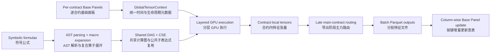

# 🚀 High-Frequency Futures Alpha Engine: GPU-Accelerated DAG Compiler
### 期货高频因子图计算与 GPU 异步并发引擎

A GPU-based quantitative feature-engineering subsystem for minute-level futures research. It compiles textual alpha formulas into an execution DAG, reuses common subexpressions, releases eligible intermediates by graph lifetime, and keeps base tensors resident on the GPU across formula batches to reduce repeated transfers.

本系统是一套面向分钟频期货研究的 GPU 特征计算引擎。它将文本因子公式编译为有向无环图（DAG），复用公共子表达式，按图生命周期释放符合条件的中间张量，并让基础张量在公式批次间驻留 GPU，以减少重复数据搬运。

---

## 🔥 Architecture at a Glance / 架构速览

### AST-Driven DAG Compilation & CSE / 基于抽象语法树的 DAG 编译与去重
*   **[EN]** The engine uses a custom Python AST `NodeTransformer` to parse alpha formulas into mathematical trees instead of evaluating arbitrary formula strings with `eval()`. It canonicalizes supported commutative operations and applies **Common Subexpression Elimination (CSE)**. If 50 formulas contain the same canonical `TsMean(close, 20)` node, that node is represented once in the shared graph.
*   **[CN]** 引擎使用 Python `ast` 与自定义 `NodeTransformer` 将因子公式解析为数学语法树，而不是直接用 `eval()` 执行任意字符串。它会规范化受支持的交换运算并执行**公共子表达式消除（CSE）**；如果 50 个公式包含同一个规范化后的 `TsMean(close, 20)` 节点，共享图中只保留一份该节点。

### Data-Stationary Formula Chunking / 基于常驻显存的公式分块
*   **[EN]** Rather than repeatedly chunking the time axis, the engine partitions the graph by formula width. Base-panel tensors are transferred to GPU memory during initialization and reused across formula batches, reducing repeated PCIe traffic during the compute phase. Initial loading, final export, and any explicit device conversion still incur I/O or copies.
*   **[CN]** 引擎不反复切分时间轴，而是按公式宽度划分计算图。基础面板张量在初始化阶段传入 GPU，并在多个公式批次间复用，从而减少计算阶段的重复 PCIe 传输；初始加载、最终导出及显式设备转换仍然会发生 I/O 或复制。

### Dual-Layer Asynchronous Execution / 双层异步流并发调度
*   **[EN]** The `BatchExecutor` coordinates two dimensions of concurrency. It respects DAG-layer barriers while using `torch.cuda.Stream` to dispatch eligible kernels for different instruments. A cross-sectional alignment bridge maps local instrument time axes (`T_i`) to a shared global axis (`Global_T`) before cross-sectional operators run.
*   **[CN]** `BatchExecutor` 协调两个维度的并发：纵向遵守 DAG 层间屏障，横向使用 `torch.cuda.Stream` 调度不同品种中可并行的核函数。截面算子执行前，动态对齐桥会把各品种局部时间轴（`T_i`）映射到共享全局时间轴（`Global_T`）。

### Topological Garbage Collection & Lifecycle Masking / 拓扑级内存回收与生命周期掩码
*   **[EN]** Every intermediate DAG node tracks its `out_degree`. At a layer barrier, an intermediate whose downstream consumers are complete becomes eligible for deletion, which helps limit peak VRAM usage. A boolean **Lifecycle Mask Matrix** excludes observations outside each contract's listed-data interval from cross-sectional calculations.
*   **[CN]** 每个 DAG 中间节点都会跟踪其 `out_degree`。在层间屏障处，下游消费者均已完成的中间张量会进入可释放状态，以控制显存峰值。布尔型**生命周期掩码矩阵（Lifecycle Mask）**则用于排除合约有数据生命周期之外的观测，减少截面统计污染。

### Strategy-Aligned Late Masking / 策略导向的延迟掩码
*   **[EN]** Instead of stitching a dominant-contract series before feature calculation, the engine computes each contract's tensors first and applies **Late Masking** during export using the configured main-contract routing. This preserves contract-local history during calculation while making the final panel follow the selected routing rule.
*   **[CN]** 引擎不会在特征计算前先拼接主力连续序列，而是先在各合约自身序列上计算张量，再在导出阶段依据既定主力合约路由执行**延迟掩码（Late Masking）**。这样既保留计算时的合约内历史，也使最终面板遵循所选主力路由规则。

---

## 🧭 Role in the Research Pipeline / 在研究流水线中的定位

**[EN]** This module is the bridge between the minute-level Base Panel and factor evaluation. Its job is not to decide whether a formula is economically meaningful; that decision belongs to the research and mining layers. Its job is to turn an already specified symbolic formula into a reproducible tensor computation, apply the same data alignment and lifecycle rules to every candidate, and export columns that can be compared under a common sample definition.

**[CN]** 本模块位于分钟级 Base Panel 与因子评测之间。它不负责判断某个公式是否具有经济意义——这属于研究与挖掘层；它负责把已经明确的符号公式转化为可复现的张量计算，对所有候选统一施加时间对齐、合约生命周期与导出规则，并生成能够在同一套样本定义下比较的特征列。

## 1. Formula Semantics Before Speed / 先固定公式语义，再讨论速度

**[EN]** A formula engine can make the wrong calculation fast, so the first design priority is a constrained language. Formulas are parsed into an AST and resolved through an explicit operator registry. Foundation features and compound operators are expanded into primitive expressions before scheduling. This keeps the final execution graph inspectable: every output can be traced back to raw fields, window parameters, and registered operators.

**[CN]** 公式引擎完全可能“高速地算错”，因此第一优先级不是性能，而是约束语言。公式先被解析为 AST，再通过显式算子注册表解析；Foundation Feature 与 Compound Operator 在调度前展开为基础表达式。最终执行图仍然可审计：每个输出都能追溯到原始字段、窗口参数与已注册算子。

### Operator boundaries / 算子边界

*   **[EN]** Time-series operators work on one contract's ordered history. Cross-sectional operators require an explicit mapping from each instrument's local clock to the global clock. These are different statistical objects and are not silently interchanged.
*   **[CN]** 时序算子作用于单一合约的有序历史；截面算子则必须先把各品种局部时间轴映射到全局时间轴。两者对应不同的统计对象，系统不会隐式混用。
*   **[EN]** Future-return operators exist for label construction. Their presence in the registry is an implementation capability, not permission to use them as predictive features. Feature/label separation must also be enforced by the formula source, review process, and experiment configuration.
*   **[CN]** 注册表中保留未来收益算子，是为了构造标签；“算子可用”不等于允许把它写入预测特征。特征与标签隔离还需要由公式来源、人工审查和实验配置共同保证。
*   **[EN]** Cross-sectional operators are optional research tools. Most of the current pipeline is contract-local, and obsolete operators should not be interpreted as mandatory parts of every experiment.
*   **[CN]** 截面算子属于可选研究工具。当前流水线的大部分计算仍以合约内时序为主，保留的历史算子不代表每个实验都必须使用。

## 2. Tensor Context and Sample Identity / 张量上下文与样本身份

**[EN]** `GlobalTensorContext` coordinates instruments, while each instrument context stores its tensors in `context_dict` together with local time and contract metadata. The key research requirement is that a numerical value never loses its sample identity: timestamp, instrument, contract, listing interval, and main-contract route must remain recoverable when the value is exported.

**[CN]** `GlobalTensorContext` 负责协调品种，每个品种上下文则在 `context_dict` 中保存张量以及局部时间、合约元数据。这里最重要的研究要求是：任何数值都不能脱离样本身份。导出时必须仍能恢复时间戳、品种、合约、有效生命周期与主力路由。

### Why compute before main-contract stitching? / 为什么先逐合约计算，再抽取主力？

**[EN]** Rolling statistics should describe the history of the contract being traded. If dominant contracts are stitched before calculation, a rollover can place two different contracts next to each other inside the same rolling window and turn a routing change into an apparent price or liquidity shock. Computing contract-local histories first and routing late avoids that specific contamination. It does not make rollover risk disappear: the exported main-contract series still needs rollover masks or strategy-level handling where appropriate.

**[CN]** 滚动统计应描述正在交易的那个合约自身的历史。如果先拼接主力连续序列，换月点可能把两个不同合约放进同一个滚动窗口，把路由变化误识别为价格或流动性冲击。先逐合约计算、最后再路由，可以避免这一类污染；但它并不会让换月风险自动消失，最终主力序列仍需要按研究目标设置换月掩码或策略层处理。

### Lifecycle masking / 生命周期掩码

**[EN]** A global timestamp grid creates structurally missing regions for contracts that were not yet listed or had already stopped appearing in the data. The lifecycle mask prevents those regions from entering cross-sectional ranks or normalizations as if they were valid zeroes. This mask describes data availability; it is not, by itself, a liquidity or tradability filter.

**[CN]** 全局时间网格会为尚未上市或已经不再有数据的合约产生结构性缺失区间。生命周期掩码用于防止这些位置以“有效零值”的形式进入截面排序或标准化。需要强调的是，它描述的是数据可用性，本身并不等价于流动性或可交易性过滤。

## 3. DAG Construction, Reuse, and Memory Lifetime / 计算图构建、复用与显存生命周期

**[EN]** Formula strings are canonicalized into graph nodes. When two formulas contain the same supported subexpression, CSE allows them to share a node. The expected benefit depends on the formula set: a family of related factors may share many rolling statistics, while unrelated formulas may share almost none. CSE is therefore an optimization with measurable hit rates, not a blanket claim that every batch becomes small.

**[CN]** 公式字符串会被规范化为图节点。当两个公式包含相同且受支持的子表达式时，CSE 可以让它们共享节点。收益取决于公式集合：同一母题衍生的因子往往共享大量滚动统计，彼此无关的公式则可能几乎没有复用。因此 CSE 是一个应当统计命中率的优化，而不是“任何批次都会显著缩小”的绝对结论。

**[EN]** Node `out_degree` is used as a lifetime signal. After all downstream consumers of an intermediate are complete, the tensor becomes eligible for deletion at the layer barrier. This reduces avoidable retention, but peak VRAM still depends on base-panel width, contract count, global-time length, graph width, and the largest simultaneous layer. Formula batching is the explicit control knob for that trade-off.

**[CN]** 节点 `out_degree` 被用作生命周期信号：当某个中间张量的下游消费者全部完成后，它会在层间屏障处进入可释放状态。这能减少无必要的驻留，但显存峰值仍取决于基础字段宽度、合约数量、全局时间长度、图宽度与最大并行层。按公式分批就是控制这一权衡的显式旋钮。

## 4. Batching and Incremental Export / 分批计算与增量落盘

**[EN]** Formula batching partitions columns, not rows. Each batch therefore refers to the same sample keys but produces a different subset of feature columns. These files must be combined by key and column; treating them as a row-wise Parquet dataset would duplicate samples and create sparse records. `../tick_to_min/update_to_basepanel.py` follows the column-patching interpretation so that new features can be added without dropping previously stored feature columns.

**[CN]** 公式分批切分的是“列”，不是“行”。因此每个批次都对应相同的样本键，但产出不同的特征列。这些文件必须按键进行横向列合并；如果把它们当作普通 Parquet Dataset 纵向堆叠，就会制造重复样本和稀疏记录。`../tick_to_min/update_to_basepanel.py` 采用按键补列的语义，使新增特征能够增量写入，同时保留已有旧特征。

**[EN]** Labels and metadata do not need to be duplicated in every factor batch as long as the merge contract is explicit and the key set is checked. The stable join identity is the combination used by the producer and Base Panel updater; any change to that identity should be treated as a schema migration rather than an incidental refactor.

**[CN]** 只要合并契约清晰且对样本键集合进行校验，标签与元数据不必在每个因子批次中重复写入。生产端与 Base Panel 更新端共同使用的连接键就是稳定的样本身份；改变这组键应被视为 schema migration，而不是普通代码重构。

## 5. Research Controls and Interpretation / 研究控制与结果解释

*   **Research period vs. OOS / 研究期与样本外**: Formula generation, transformation, and selection performed on 2024 data are in-sample research activities. A 2025 result is only OOS if no 2025 labels, diagnostics, thresholds, or manual choices influenced the formula set beforehand. / 使用 2024 数据完成的公式生成、变换与筛选都属于样本内研究。只有在公式集合事先完全未受 2025 标签、诊断、阈值或人工选择影响时，2025 结果才可以称为 OOS。
*   **Overlapping labels / 重叠标签**: Minute observations paired with 15- or 30-minute forward returns are serially overlapping. A large row count is not the same as a large number of independent bets. Period aggregation, embargoes, and final backtests should be interpreted with that dependence in mind. / 分钟样本对应 15 或 30 分钟未来收益时会高度重叠。行数很多并不等于独立下注次数很多；Period 聚合、embargo 与最终回测都需要在这一依赖结构下解释。
*   **Numerical validity vs. economic validity / 数值有效与经济有效**: Successful parsing and finite tensor output prove only that a formula can be calculated. They do not establish a plausible mechanism, stability, net profitability, or capacity. Those questions belong to the evaluation and simulation stages. / 解析成功并输出有限张量，只能证明公式“算得出来”；它不能证明机制合理、表现稳定、扣费后盈利或具备容量，这些问题需要由评测与仿真阶段回答。
*   **GPU-only scope / GPU 能力边界**: The current executor assumes CUDA streams and CUDA memory-management calls. It should be described and deployed as a GPU engine; this repository does not claim a transparent CPU fallback. / 当前执行器依赖 CUDA Stream 与 CUDA 显存管理调用，因此应明确按 GPU 引擎部署；本仓库不声称提供透明的 CPU fallback。

## 6. Module Map / 文件职责

| Module | Responsibility / 职责 |
|---|---|
| `tensor_context.py` | Loads per-instrument tensors, time indices, contract metadata, and lifecycle masks. / 加载逐品种张量、时间轴、合约元数据与生命周期掩码。 |
| `dag_scheduler.py` | Parses formulas, creates shared nodes, records dependencies, and produces execution layers. / 解析公式、建立共享节点与依赖关系，并生成执行层。 |
| `batch_executor.py` | Resolves registered operators and executes DAG layers with CUDA streams. / 解析注册算子，并通过 CUDA Stream 执行各层计算图。 |
| `ops/` | Primitive time-series, cross-sectional, arithmetic, and future-label operators. / 基础时序、截面、算术与未来标签算子。 |
| `feature_calculation.py` | Orchestrates context construction, formula batches, export, and main-contract selection. / 调度上下文构建、公式分批、导出与主力合约选择。 |