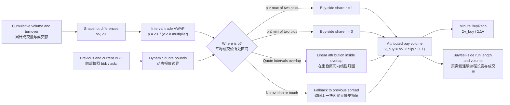

# 🧬 LLM-GA & High-Frequency Futures Alpha Engine / 大模型高频微观因子挖掘与计算系统

**[EN]** This project is a high/mid-frequency quantitative feature mining and execution pipeline that processes raw snapshot data into trading signals ready for simulated backtesting. The system features a **dual-phase, dual-engine architecture**: the bottom layer combines a C++ symbolic-tracing engine with a RAG-assisted workflow to design snapshot aggregation logic and transform 500 ms data into microstructure base fields; the upper layer uses a GPU DAG engine and a multi-round, 5-layer LLM workflow to generate and evaluate minute-level Alpha candidates. The remaining stages cover community-based feature redundancy reduction for selected instrument pools, feature-evaluation dashboards, tree-model signal generation and target-position mapping, and NautilusTrader simulation.

**[CN]** 本项目是一套从原始快照数据到可进入模拟交易回测的高/中频量化特征研究与执行流水线。系统采用**两阶段双引擎架构**：底层把 C++ 符号追踪引擎与 RAG 辅助研究流程结合，将 500 ms 快照聚合为微观结构基础字段；上层使用 GPU DAG 引擎与多轮 5 层 LLM 流程生成并评估分钟频 Alpha 候选。后续阶段覆盖面向目标品种池的社区网络去冗余、特征评价看板、树模型信号与目标仓位映射，以及 NautilusTrader 仿真回测。

> ⚠️ **Disclaimer / 特别声明**
> * **[EN]** This repository serves strictly as a replication and showcase of past quantitative research methodologies. It is **not** plug-and-play out of the box due to strict dependencies on proprietary institutional data interfaces. Furthermore, certain core proprietary libraries (e.g., specific foundation templates in `base_features`) have been stripped or reduced to bare minimums for demonstration purposes, and as a replication effort, some useful technical nuances and optimizations from the original system have not yet been fully added in.
> * **[CN]** 本仓库仅作为过往量化研究经验与系统架构设计的复现与展示。由于高度依赖特定的底层数据接口，本项目**并非开箱即用**。同时，部分核心底层依赖（如 `base_features` 中的具体基础因子库）已被剥离或仅保留最小化示例，且由于是复现工程，部分曾实现过的实用细节技巧尚未加入其中。
> 

> 📚 **Documentation Note / 文档指引**
> * **[EN]** For more rich and detailed technical information regarding specific components, please note that **each subfolder in this repository contains its own dedicated and comprehensive `README.md`**.
> * **[CN]** 为了提供更加丰富、硬核的技术细节，**本仓库的每一个子文件夹下都配有专属且详细的 `README.md` 说明文档**，欢迎深入各个模块查阅。

> 🧭 **Core Research Thesis / 核心研究主张**
> * **[EN]** The LLM in this system is not treated as an autonomous black-box formula generator. It is positioned as an **interpretable hypothesis generator operating inside an auditable research loop**: economic intuition precedes code, transformations remain symbolic, and every candidate can be traced, challenged, decomposed, and rejected. Reviews of prior experimental outputs showed that this constrained process generally produced factors with coherent microstructure logic rather than arbitrary mathematical nesting.
> * **[CN]** 本系统并不把 LLM 当作自主运转的黑盒公式生成器，而是将其定位为**可审计研究闭环中的可解释假设生成器**：经济与微观结构逻辑先于代码，各步变换保持为符号公式，每个候选都可被追溯、质疑、拆解与否决。对早期实验产出的复盘也表明，这种受约束的生成过程通常能保留较清晰的微观交易逻辑，而不是制造任意的数学嵌套。

---

## 🔬 Phase 1: Microstructure Aggregation (500ms ➔ 1-Min) / 阶段一：微观快照降频系统

### 1.1 C++ Symbolic Tracing Engine / C++ 符号追踪底座
Designed to process high/mid-frequency Level-2 snapshot data into minute-level aggregated features. / 专为处理 500ms L2 快照设计的高频聚合底座。

*   **Contiguous Buffer Handoff & C++ Native Execution**: Tick data is loaded into contiguous NumPy arrays and exposed to the C++ engine through PyBind11 buffer pointers. The row-wise numerical loop runs in C++ rather than being dispatched from Python for every snapshot. This describes the binding boundary; it is not a claim that the complete I/O pipeline performs no copies. (Tick 数据先整理为连续 NumPy 数组，再通过 PyBind11 的缓冲区指针交给 C++ 引擎；逐行数值循环在 C++ 内完成，避免每个快照都由 Python 调度。这里描述的是绑定边界，并不声称端到端 I/O 全程没有任何内存复制)。
*   **Symbolic Tracing Graph**: Python acts as a blueprint drawer (`ce.IfElse`, `ce.ConstNode`). The C++ engine dynamically allocates memory and processes the data pipeline based on this DAG. (Python 端仅作“画图连线”，底层 C++ 引擎据此动态构建状态算子流水线)。
*   **Atomic to Complex (原子算子构建复杂逻辑)**: Although the engine relies on atomic operators, these primitives can be flexibly combined to construct highly complex conditional judgments and stateful logic (e.g., using `TsResetable` for conditional run-length computations). (虽然底层调用的是原子化算子，但通过灵活组合，已足以构造出极度复杂的条件判断与状态机逻辑，如带条件打断的连涨/连跌游程计算)。

#### 💡 Research Rationale & Microstructure Nuances / 研究考量与微观处理:
*   **Missing Ticks Philosophy (缺失快照的处理)**: A minute theoretically has 120 snapshots at 500 ms, but missing updates are common. Forward-filling may be appropriate when reconstructing the latest observable book; for statistical aggregation, repeated static snapshots can inflate the apparent sample count and alter volatility or variance estimates. This implementation preserves observed sparsity and records the actual `tick_count`, allowing affected formulas to use the observed count in their denominators. (500 ms 频率下每分钟理论上有 120 个快照，但缺失推送很常见。如果目标是重建当时可见盘口，前向填充有其合理性；但用于统计聚合时，重复静态快照会放大表观样本数并改变波动率、方差等估计。本实现保留实际观测的稀疏性并记录真实 `tick_count`，使相关公式能够使用观测数量调整分母)。
*   **Small Sample & Opening Bar Protection (小样本与开盘保护)**: At market open or during extreme illiquidity, a minute might only receive a single auction tick or highly sparse updates. We implement a strict valid tick count threshold (e.g., >20 valid ticks). If not met, the feature is safely masked as `NaN` to prevent extreme mathematical distortion. (刚开盘时往往只有集合竞价后的单笔 tick，或遭遇极端冷门时段。我们在计算特定字段时设置了“有效快照数”门槛。样本量不足时强制置为 `NaN`，防止单一样本引发极端失真的离群值)。
*   **Limit Moves & Zero-Division (涨跌停与防零除保护)**: Modern data feeds often continue publishing quote states during limit moves, so the feature layer does not automatically truncate those observations. Dynamic denominators are guarded with `ce.IfElse` to reduce invalid divisions under empty or degenerate books. (现代快照数据源在涨跌停时通常仍会推送盘口状态，因此特征层不会自动截断这些观测；动态分母通过 `ce.IfElse` 做保护，以减少空盘口或退化盘口下的非法除法)。

### 1.2 RAG-Assisted Research Agent / RAG 辅助微观逻辑研究
Bridges the gap between natural language economic intuition and high/mid-frequency C++ execution. / 打通“自然语言微观直觉”到“极高频 C++ 算子落地”的次元壁。

*   **Economic Intuition (逻辑三问)**: Forces the LLM to articulate: *What drives returns? Who is the loser? Why does it persist?* before generating any code. (强制大模型在写代码前回答：赚谁的钱？对手盘为何亏损？异象为何持续？确保逻辑先于代码)。
*   **Dual-Payload Semantic Retrieval (双载荷语义检索)**: Queries the local RAG vector database using the economic mechanism as the embedding text, while keeping generated code and evaluation metrics as payload metadata. This reduces syntax noise without assuming that semantic duplicates can be detected perfectly. (使用经济机制文本查询本地 RAG 向量库，同时将生成代码与评测指标保存在元数据中；这种设计减少代码语法对语义检索的干扰，但不假设能够完整识别所有重复想法)。
*   **Review-Gated Reflection Loop (带人工闸门的反思闭环)**: After evaluation, metrics such as Period IC and Q10-Q1 spread can be passed to the LLM for diagnostic reflection and stored in the RAG database. Newly generated classes are syntax-checked and saved as candidates; they are not executed or registered in `run.py` until a researcher reviews them. (评测后可将 Period IC、Q10-Q1 等指标交给 LLM 形成诊断反思并写回 RAG 经验库。新生成的类只会在静态语法校验后保存为候选，不会在未经研究员审查的情况下自动执行或注册到 `run.py`)。

#### 💡 Research Rationale / 研究考量:
*   **Mitigating Repetition via Research Memory (用研究记忆减少重复探索)**: An unguided LLM can repeatedly propose familiar constructions or variations of earlier failed ideas. Retrieving prior hypotheses, metrics, and reflections gives the model an explicit record of what was tried and why it may have failed. This is a research aid rather than a guarantee against hallucination or overfitting. (缺少历史上下文时，LLM 容易重复提出熟悉构造或此前失败思路的变体。检索过往假设、指标与反思，相当于提供一份可查阅的研究“错题本”；它能减少重复探索，但不能保证消除幻觉或过拟合)。

### 1.3 Core Base Field Example: Quote-Constrained Trade-Flow Attribution / 核心底层字段示例：盘口约束下的成交量方向归因

**[EN]** `BuyRatio` is not presented as an “investor-intention detector,” nor does snapshot data permit exact reconstruction of every trade's aggressor side. The implementation first differences cumulative volume and turnover to recover the traded volume and average execution price between two snapshots. It then locates that price relative to the **previous and current best bid/ask quotes**, assigning the incremental volume to the buy and sell sides either fully or proportionally. This produces a transparent, deterministic estimate of trade-flow direction without using displayed queue size as the primary classifier.

**[CN]** `BuyRatio` 并不是所谓的“买卖意愿识别”，快照数据也不足以精确还原每一笔成交的真实主动方。代码首先对累计成交量与累计成交额做差分，得到相邻快照之间的成交增量及其平均成交价；随后将该价格放入**前后两个快照的买一/卖一报价区间**中定位，对增量成交量进行全额或按比例的买卖侧归因。它本质上是一套透明、确定性的成交方向估计规则，并不把容易变化的盘口排队量作为主要分类依据。



Let `b⁻, a⁻` denote the previous best bid/ask and `b, a` the current quotes. The update-level buy-side share is computed as follows. / 记 `b⁻, a⁻` 为上一快照的买一/卖一价，`b, a` 为当前报价，则单次更新的买侧归因比例按下表计算：

| Price region / 价格区域 | Buy-side share `r` / 买侧比例 | Meaning / 含义 |
|---|---:|---|
| `p ≥ max(a⁻, a)` | `1` | Attribute all incremental volume to the buy side / 增量成交量全部归于买侧 |
| `p ≤ min(b⁻, b)` | `0` | Attribute all incremental volume to the sell side / 增量成交量全部归于卖侧 |
| `max(b⁻, b) < min(a⁻, a)` | `clip((p - max(b⁻, b)) / (min(a⁻, a) - max(b⁻, b)), 0, 1)` | Proportional attribution inside the overlap of the two quote intervals / 在前后报价区间的交集内按价格位置线性归因 |
| `max(b⁻, b) ≥ min(a⁻, a)` | `clip((p - b⁻) / (a⁻ - b⁻), 0, 1)` | When the quote intervals do not overlap or merely touch, fall back to the previous spread / 前后报价区间不重叠或仅接触时，退回上一快照买卖价差内插值 |

**[EN]** The important design choice is to preserve the temporal roles of the two quote states. Their common price interval is used when it exists; when the intervals do not overlap or merely touch, attribution falls back to the **previous** spread because the current quote may already contain post-trade repricing. This avoids reversing the canonical case in which a trade executes at the old ask or bid and the book subsequently moves by one tick. The tick-level attributed volume is volume-weighted into the minute-level `BuyRatio`; the same transparent share also drives consecutive buy-/sell-side run-length and run-volume fields. Zero-volume updates carry zero weight, unsafe denominators are guarded, and minutes with insufficient valid snapshots are masked. The output remains an estimator—not an exchange-provided aggressor flag—which keeps its interpretation and limitations explicit.

**[CN]** 这一构造的关键并不是给成交贴一个武断的“主动买/主动卖”硬标签，而是区分前后两个盘口状态在时间上的不同角色：存在有效交集时使用共同价格区间；前后报价区间不重叠或仅接触时，则退回**上一快照**买卖价差，因为当前盘口可能已经包含该段成交造成的价格重定向。这样可以避免“成交发生在旧卖一或旧买一，随后盘口恰好移动一档”时出现方向反转。Tick 级归因成交量按真实成交增量加权汇总为分钟级 `BuyRatio`，同一比例还用于构造买卖侧连续游程的长度与累计成交量字段。零成交量更新不会获得权重，动态分母均有防零保护，有效快照不足的分钟则被屏蔽。最终输出仍然是估计量，而不是交易所提供的真实主动方标记，其经济含义与能力边界都可以被清楚审计。

---

## 🚀 Phase 2: Alpha Evolution (1-Min ➔ Deep Alpha) / 阶段二：分钟频高阶演化系统

### 2.1 GPU-Accelerated DAG Compiler / GPU 常驻显存编译引擎
A GPU subsystem for batched minute-level feature engineering. / 面向分钟频批量特征计算的 GPU 执行底座。

*   **AST-Driven Compilation & CSE**: Uses a Python AST `NodeTransformer` to parse formulas and applies Common Subexpression Elimination (CSE) to reuse matching graph nodes. (基于抽象语法树编译 DAG，并通过公共子表达式消除复用相同图节点)。
*   **Data-Stationary Formula Chunking**: Base tensors remain resident on the GPU while formulas are dispatched in batches, reducing repeated CPU-GPU transfers during computation. (基础张量在批次计算期间驻留 GPU，公式按批调度，从而减少重复的 CPU-GPU 数据搬运)。

<p align="center">
  
</p>

### 2.2 The 5-Layer Genetic Pipeline / 5层定向基因突变架构
Instead of blind formula generation, the LLM progresses through a strictly scaffolded pipeline. The primary objective of this system is to proactively search for **"Strong Features" (Factors)** that can be directly consumed by tree-based models, while strictly capping mathematical complexity to prevent overfitting.
系统禁止大模型一口气写完逻辑，将其拆解为 5 道靶向流水线。本系统的核心目标是主动定向搜索**“强特征（因子）”**以供树模型直接使用，同时严格限制公式的数学复杂度以防过拟合。

*   **[L1] Logical Genesis (基础逻辑构建层)**: Goes beyond mere template injection. It leverages the `Base Features` library to construct foundational, economically meaningful operations. This involves both deep time-series computations on a single base field and rich cross-sectional interactions across multiple base fields to form a solid logical bedrock. (绝非简单的模板注入，而是利用 `Base Features` 库构造具备坚实微观逻辑的初始运算。这不仅包含单一基础字段的复杂时序逻辑计算，更包含多个基础字段间的丰富交互组合，为后续演化奠定最具物理意义的基石)。
*   **[L2] Relativization (截面相对化层)**: Reduces price- and volume-scale differences to improve cross-sectional comparability. The prompt asks the LLM to justify its scaling choice economically rather than applying transformations without a stated reason. (通过规模调整降低跨品种价格与流动性量级差异，并要求 LLM 说明缩放方式的经济含义，而不是无理由地叠加数学变换)。
*   **[L3] Monotonicity & Distribution (分布与单调性诊断层)**: Feeds 10-quantile return profiles back to the LLM so it can diagnose U-shaped or non-monotonic responses and propose explicit transformations. The resulting candidates remain subject to later evaluation. (向 LLM 提供 10 分组收益率均值图，用于诊断 U 型或非单调响应并提出显式变换；变换后的候选仍需接受后续评估)。
*   **[L4] Temporal Interaction (复杂时序交互层)**: Opens access to the `Compound Operators` library. The LLM is inspired to self-create deep-nested recursive structures (e.g., EWMAC on volatility-adjusted momentum), discovering higher-order market microstructure dynamics. (开放 `Compound Operators` 高阶复合算子库。启发 LLM 在保留前期物理逻辑的前提下，自创深度嵌套的复杂时序计算，挖掘更高阶的微观博弈动态)。
*   **[L5] Smoothing & Sweeping (降噪与参数网格扫荡)**: Enforces exponential smoothing to filter microstructure noise and mandates the generation of multiple time-window variants for grid sweeping to verify the alpha's survival boundaries. (强制施加指数平滑过滤微观噪音，并强行衍生出多个不同数量级的时间窗口进行网格扫荡，以探索该因子在不同周期下的存活边界)。

#### ⚙️ Evolutionary Infrastructure / 演化基建与 E&E 博弈
**[EN]** *Across all five layers, the prompt asks the LLM to preserve an economic interpretation and justify mathematical transformations.* The pipeline is supported by:
1.  **Component Libraries**: The `Base Features` and `Compound Operators` libraries serve as the system's fundamental building blocks.
2.  **Inter-Layer Material Pools (蓄水池)**: Retains successfully mutated genes across layers.
3.  **Lessons Learned Database (经验库)**: Every attempted feature is analyzed by the LLM, logging its mathematical successes or reasons for failure.
The system leverages these facilities to dynamically trade off between **Exploitation** (deep-diving into newly discovered promising branches) and **Exploration** (reviving and mutating dormant, orthogonal ideas from the pool to escape local optima).
**[CN]** *在五个阶段中，Prompt 都要求 LLM 保留经济解释并说明数学变换的理由。* 支撑该流程的组件包括作为积木的**基础字段与高阶算子库**、跨层流转的**原料蓄水池**，以及记录候选表现和反思的**历史经验库（Lessons Learned）**。系统利用这些组件，在**深度利用（Exploitation）**与**广度探索（Exploration）**之间进行可配置的抽样平衡。

#### 💡 Research Rationale / 研究考量:
*   **Strong Feature vs. Weak Feature Paradigm (强特征 vs 弱特征的量化流派博弈)**: This pipeline targets the **"Strong Feature + comparatively simple model"** research style. Layers 4 and 5 express temporal interactions and smoothing as symbolic formulas, making the learned hypothesis easier to inspect than an entirely latent representation. This improves auditability, but does not remove overfitting risk; formula depth, parameter variants, and evaluation boundaries still need control. (本系统选择**“强特征 + 相对简单模型”**的研究路线。第 4、5 层把时序交互与平滑显式写成符号公式，相比完全隐式的表征更便于审查；但这并不消除过拟合风险，仍需约束公式深度、参数变体与评测边界)。
*   **AST Lineage Tracing for Deep Learning (面向深度学习的 AST 血缘溯源展望)**: A supporting analysis script can parse formula strings into AST-like lineage graphs and expose recurring subexpressions as possible "Root Formulas". These roots are candidates for simpler model inputs, not automatically high-SNR features. *(Note: this remains an auxiliary analysis direction rather than a fully integrated production stage.)* (辅助分析脚本可以把公式字符串解析为类似 AST 的血缘图，并识别重复出现的子表达式作为候选 “Root Formula”。这些根节点只是更简洁模型输入的候选，并不天然等于高信噪比特征；当前它仍是辅助分析方向，而非完整集成的生产阶段)。

### 2.3 Interpretability as a Research Constraint / 将可解释性作为研究硬约束

*   **Traceable Hypotheses, Falsifiable Results (可追溯的假设，可证伪的结果)**: Interpretability is enforced structurally rather than added after a backtest: the economic mechanism, parent material, symbolic transformations, parameter variants, metrics, and reflection remain linked. The LLM may propose hypotheses, but only compilable formulas and reproducible tests can promote them; even failed candidates become useful, explainable boundary conditions. (可解释性不是回测后补写的故事，而是被写入研究结构：经济机制、父代原料、符号变换、参数变体、评价指标与事后反思始终关联。LLM 可以提出假设，但只有可编译的公式与可复现的实证检验才能让其晋级；失败候选也能沉淀为逻辑清晰的研究边界)。
*   **Scaffolded Creativity and Reusable Complexity (脚手架式创新与可复用复杂度)**: Experiments showed that an unguided LLM tends to recombine familiar ideas and converge toward overly simple constructions. `Base Features` provide meaningful starting points, `Compound Operators` expose reusable higher-order motifs and inspire analogous nested logic, while RAG supplies empirical memory. Together they form a research curriculum that encourages controlled novelty without surrendering auditability. (实验表明，缺少引导的 LLM 倾向于重组熟悉概念，并收敛到过于简单的构造。`Base Features` 提供有意义的研究起点，`Compound Operators` 展示可复用的高阶计算母题并启发类似的嵌套逻辑，RAG 则提供实证记忆。三者共同构成一套在保持可审计性的前提下鼓励受控创新的“研究课程”)。

### 2.4 Experimental Directions Not Yet Fully Tuned / 尚未完成最终调优的实验方向

*   **Human-Maintained Textual Idea Bank (人工维护的纯文字 Idea 库)**: An earlier prototype allowed researchers to maintain code-free idea cards describing market behaviors, counterparty mistakes, or unusual microstructure observations. A random subset could be injected into each prompt as creative stimulation. Unlike formula templates, these cards deliberately describe *what may be happening* without prescribing *how to calculate it*, preserving room for the LLM to translate human intuition into multiple competing implementations. The sampling and attribution mechanism was explored but has not yet been fully tuned or integrated into the current pipeline. (早期原型曾允许研究员维护一个不含代码的纯文字 Idea 库，用来记录市场行为、对手盘错误或异常的微观结构观察。每轮从中随机抽样少量想法注入 Prompt，作为创新刺激。与公式模板不同，这些卡片只描述“市场可能发生了什么”，而不规定“必须怎样计算”，从而保留 LLM 将人类直觉翻译成多种竞争性实现的空间。该思路已做过尝试，但随机抽样与贡献归因机制尚未完成最终调优和正式集成)。
*   **Extreme-Outcome Clue Mining (极端收益样本的线索挖掘)**: Another research direction is to isolate the in-sample observations with large absolute future-return labels, then summarize their pre-event order-book statistics, temporal paths, and distributional signatures as textual evidence for the LLM. A rigorous version should compare positive and negative tails against matched non-extreme controls with similar instrument, session, volatility, and liquidity conditions; otherwise the LLM may merely rediscover the trivial statement that high volatility accompanies large returns. The intended output is a compact set of clue cards rather than row-level future labels, and all extraction must be frozen strictly within the in-sample period before OOS evaluation. (另一个研究方向是专门提取样本内未来收益率标签绝对值较大的观测，统计事件发生前的订单簿指标、时序路径与分布特征，再将其压缩成可供 LLM 理解的启发线索。更严谨的实现不应只看极端样本，而应将正、负收益尾部与品种、时段、波动率和流动性相近的非极端对照样本比较，否则 LLM 很可能只是重新发现“高波动伴随大收益”这种平凡结论。计划注入 Prompt 的应是压缩后的线索卡片，而不是逐行的未来标签；全部提取过程也必须严格冻结在样本内，然后才能进入 OOS 评估)。
*   **Measuring Where Novelty Comes From (对“创新来源”做可归因评估)**: A remaining methodological question is how much incremental novelty comes from textual ideas, foundation features, compound operators, RAG memories, or stochastic prompt sampling. A future ablation framework should remove these sources one at a time and measure formula-tree diversity, semantic duplication, compile success, and out-of-sample survival—not merely the best IC obtained in one run. (一个尚待回答的方法论问题是：新增创意究竟有多少来自纯文字想法、基础特征、复合算子、RAG 记忆或 Prompt 的随机抽样。未来可以建立消融实验，逐一移除不同启发源，比较公式树多样性、语义重复率、编译成功率与样本外存活率，而不是只对比某一轮挖掘中出现的最佳 IC)。

---

## 🕸️ Phase 3: Graph-Based Feature Selection / 阶段三：基于社区网络的特征正交与分层初筛

Before feeding features into complex machine learning models, the system employs rigorous network theory and a hierarchical voting mechanism to deduplicate and extract orthogonal Alphas (`select_feature.py`). / 在进入树模型前，利用社区网络与分层投票机制进行严格的因子正交去重与可用性初筛。

*   **Hierarchical Community Discovery & Voting (社区发现与分层投票筛选)**:
    1. **Single-Instrument Pre-selection**: Within each highly-collinear feature community (extracted via Greedy Modularity), the system pre-selects the best performing feature for *each individual instrument* based on historical metrics. (单品种社区内预选：在每个高内聚的共线性特征社区内，首先针对单个品种，依据历史指标挑选出最优特征)。
    2. **Target Pool Coverage Retention**: A community is only retained if it provides valid Alpha for a sufficient ratio (e.g., 20%) of the entire target pool. (全池覆盖率保留：如果某个社区选出的特征无法覆盖目标品种池中足够比例的品种，该特征社区将被整体淘汰)。
    3. **Intra-Community Voting & Tie-breaking**: Features receive instrument-level votes within each community. Ties are broken with pooled IC under the configured sample mask, yielding one representative under the chosen metric. (社区内统计品种级选票，平票时使用既定样本掩码下的 Pooled IC 决胜，从而按所选指标保留一个代表特征)。
*   **Tradability Masking (可交易样本屏蔽)**: The pooled calculation excludes configured end-of-day, illiquid-night-session, and rollover samples to reduce contamination from periods outside the intended trading scope. (混池计算按配置剔除尾盘、低流动性夜盘与换月样本，以减少非目标交易时段的污染)。

---

## 🔍 Phase 4: High-Resolution Evaluation & Dashboard / 阶段四：高分辨率特征评价与看板

`feature_quality.py` provides multiprocessed diagnostics for the **2024 in-sample research period**. Its IC, quantile, direction, and simulation results are selection evidence rather than OOS claims; a later untouched period is required for OOS evaluation. / `feature_quality.py` 对 **2024 年样本内研究期**进行多进程诊断。其 IC、分组、方向与模拟结果属于筛选证据，而不是 OOS 结论；样本外评估需要另行保留未参与研究的后续时期。

*   **Period IC (2000-minute window)**: Uses non-overlapping 2000-minute windows to keep the evaluation scale consistent across instruments with different daily session lengths. (采用 2000 分钟不重叠窗口，使不同日内交易时长的品种使用一致的评价尺度)。
*   **Decile Return Spreads (Q10 - Q1)**: Automatically buckets features into 10 quantiles to track monotonicity. (自动划分为 10 组追踪单调性与多空收益差)。
*   **AlphaMiner Pro Dashboard**: An interactive Streamlit app (`dashboard_app.py`) providing Feature-Centric Drilldowns and Scope-Centric Rankings. (交互式看板，支持单特征下钻与全市场横向阈值排行榜)。

---

## 📈 Phase 5: Position Mapping & Execution / 阶段五：模型预测值的仓位映射与仿真回测

Converting raw model predictions (which typically represent expected returns, especially when trained with RMSE-like loss functions) into actual trading target positions ([-1.0, 1.0]) is a critical final step. `tree_models.py` implements several rigorous position mapping methods rather than a single naive scaling approach.
将模型输出的原始预测值（尤其是在基于 RMSE 类损失函数训练时，预测值自带“预期收益率”的物理意义）转化为实际的交易目标仓位 ([-1.0, 1.0]) 是至关重要的一步。我们在 `tree_models.py` 中实现了多种严谨的仓位映射方法。

#### 1. Position Mapping Methods / 核心仓位映射方法
*   **Timeframe Anchoring (时间基准提取)**:
    *   *Real-time Rolling Windows (实时滚动回看)*: Calculates scaling statistics (mean, std, quantiles) based on a dynamic trailing historical window. (基于一段动态滚动的历史窗口来计算缩放所需的统计量)。
    *   *In-Sample Static Anchoring (样本内静态锚定)*: Extracts exact distribution constants directly from the entire In-Sample (IS) training period and freezes them for Out-of-Sample (OOS) application. (直接从完整的样本内全量数据中提取统计量，并作为绝对常数冻结应用到样本外)。
*   **Scaling Mathematics (数值缩放方式)**:
    *   *Z-Score (Demean vs. No-Demean)*: Standardizes the raw predictions. Demeaning targets cross-sectional relative strength, while No-Demean preserves absolute momentum. (利用标准差对预测值进行 Z-Score 映射。分为减均值与不减均值两种处理)。
    *   *Non-Linear Extremum / Quantile Mapping*: Uses hard percentiles or Interquartile Range (IQR) to map predictions, applying distinct transformations to extreme versus median values. (基于分位数或 IQR 进行非线性映射，对极值区间和中位数区间施加不同的转换)。

#### 💡 Research Rationale & Pitfalls / 研究考量与实盘陷阱:
*   **The "Demean" Dilemma in One-Sided Markets (减均值困境与单边行情)**: A return model may produce mostly same-signed predictions during a one-sided OOS regime. Demeaning then introduces opposing positions by construction, which can work against the directional signal. The choice between Demean and No-Demean is therefore a trade-off between cross-sectional neutrality and directional exposure, to be evaluated together with target design and risk controls. (在单边 OOS 行情中，收益模型可能给出大量同符号预测；减均值会按构造产生相反方向的仓位，可能削弱方向信号。因此是否减均值，是截面中性与方向暴露之间的权衡，需要与预测目标和风险控制一起评估)。
*   **Distribution Shift Assumptions (应对分布漂移的时间基准博弈)**: IS-static and rolling mappings encode different assumptions about non-stationarity. Static anchoring uses a larger fixed training sample and is less reactive; rolling windows use recent history and are more adaptive but also more sensitive to local noise and turnover. (样本内静态锚定与滚动映射对应不同的非平稳性假设：静态方案使用更大的固定训练样本、反应较慢；滚动方案依赖近期历史、适应更快，但也更容易受局部噪声与换手影响)。
*   **Weak Signal Suppression & Non-Linearity (弱信号区的非线性抑制)**: In the observed research-period quantile charts, return separation was often concentrated in the tails of the prediction distribution. This motivates testing non-linear mappings that reduce exposure around the center and allocate more risk to configured tail regions, while treating the result as an empirical hypothesis rather than a universal rule. (在已观察的研究期分组图中，收益差异经常集中在预测分布尾部。这促使我们测试非线性映射：降低中部区域暴露，并把更多风险配置到设定的尾部区间；这一做法仍被视为实证假设，而不是普遍规律)。

> **Simulation Layer**: Precomputed target signals are fed into a daily-isolated NautilusTrader simulation that implements the repository's dynamic-event and fixed-grid execution rules under explicit fee and slippage assumptions. (预先计算的目标信号会被送入按交易日隔离的 NautilusTrader 仿真环境，并在显式手续费与滑点假设下执行动态事件与固定网格规则)。

---

## 🛠️ Quick Start / 快速启动指南

### 1. Phase 1: Microstructure Tick Mining (500ms ➔ 1Min)
```bash
# Compile the C++ DAG Engine (the script resolves its own directory)
bash tick_to_min/build.sh

# Generate a candidate class; review and register it explicitly before execution
python tick_to_min/miner_agent.py

# Process L2 snapshots into minute-frequency Base Panel features
nohup python tick_to_min/run.py > run_tick.log 2>&1 &
```
