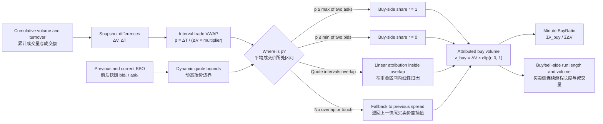

# 🧬 期货日内高频可解释特征挖掘LLM系统 / Interpretable High-Frequency Futures Feature Mining LLM System

**[EN]** This project is a high/mid-frequency quantitative feature research and execution pipeline that processes raw snapshot data into trading signals ready for simulated backtesting. The system features a **dual-phase, dual-engine architecture**. Phase 1 uses two complementary routes: constrained LLM exploration of snapshot-level mechanisms, and researcher-proposed strong mechanisms that the LLM translates into reviewable `BaseTickFeature` graphs. Both routes share the same C++ symbolic-tracing engine that transforms 500 ms snapshots into minute-level base fields. Phase 2 uses a GPU DAG engine and a multi-round, 5-layer LLM workflow to generate and evaluate minute-level Alpha candidates. The remaining stages cover community-based feature redundancy reduction for selected instrument pools, feature-evaluation dashboards, tree-model signal generation and target-position mapping, and NautilusTrader simulation.

**[CN]** 本项目是一套从原始快照数据到可进入模拟交易回测的高/中频量化特征研究与执行流水线，采用**两阶段双引擎架构**。Phase 1 包含两条互补路径：一条通过约束式 Prompt 让 LLM 主动探索快照级微观机制；另一条由研究员提出强逻辑 Idea，再让 LLM 将明确的自然语言计算说明翻译为可审查的 `BaseTickFeature` 计算图。两条路径共用 C++ 符号追踪引擎，把 500 ms 快照聚合为分钟频基础字段。Phase 2 则使用 GPU DAG 引擎与多轮 5 层 LLM 流程生成并评估分钟频 Alpha 候选。后续阶段覆盖面向目标品种池的社区网络去冗余、特征评价看板、树模型信号与目标仓位映射，以及 NautilusTrader 仿真回测。

> ⚠️ **Disclaimer / 特别声明**
> * **[EN]** This repository serves strictly as a replication and showcase of past quantitative research methodologies. It is **not** plug-and-play out of the box due to strict dependencies on proprietary institutional data interfaces. Furthermore, certain core proprietary libraries (e.g., specific foundation templates in `base_features`) have been stripped or reduced to bare minimums for demonstration purposes, and as a replication effort, some useful technical nuances and optimizations from the original system have not yet been fully added in.
> * **[CN]** 本仓库仅作为过往量化研究经验与个人系统架构设计的复现与展示。由于高度依赖特定的底层数据接口，本项目**并非开箱即用**。同时，部分核心底层依赖（如 `base_features` 中的具体基础因子库）已被剥离或仅保留最小化示例，且由于是复现工程，部分曾实现过的实用细节技巧尚未加入其中。
> 

> 📚 **Documentation Note / 文档指引**
> * **[EN]** For more rich and detailed technical information regarding specific components, please note that **each subfolder in this repository contains its own dedicated and comprehensive `README.md`**.
> * **[CN]** 为了提供更加丰富、硬核的技术细节，**本仓库的每一个子文件夹下都配有专属且详细的 `README.md` 说明文档**，欢迎深入各个模块查阅。

> 🧭 **Core Research Thesis / 核心研究主张**
> * **[EN]** The LLM does not play one undifferentiated role throughout the system. Phase 1 deliberately keeps both LLM-originated exploration and researcher-originated mechanism design: the former tests whether constrained prompts and research memory can elicit new hypotheses, while the latter uses the LLM as a translator from a strong human idea into a symbolic graph. Phase 2 gives the LLM a broader role as a scaffolded hypothesis generator and diagnostic partner. In every route, economic logic precedes execution, transformations remain inspectable, and the researcher retains approval authority.
> * **[CN]** LLM 在本系统中并不是从头到尾扮演同一种角色。Phase 1 刻意保留“LLM 主动探索”和“研究员原创机制”两条路径：前者检验受约束 Prompt 与研究记忆能否启发新的假设，后者则把 LLM 用作从强人工 Idea 到符号计算图的转译器。Phase 2 中，LLM 才进一步承担脚手架约束下的假设生成与诊断角色。无论哪条路径，经济逻辑都先于执行，变换过程保持可审查，并由研究员保留最终决定权。

---

## 🗺️ System Architecture & Pipeline Overview / 全流程架构与核心要点概览

**[EN]** This project is an end-to-end, **human-in-the-loop and LLM-assisted** quantitative research and execution pipeline spanning raw 500 ms Level-2 snapshots, minute-level factor evolution, graph-based orthogonal selection, and event-driven backtesting. Phase 1 and Phase 2 assign different—and sometimes parallel—responsibilities to the researcher and the LLM:
* **Phase 1 (Dual-Track Snapshot Microstructure Research)**: This is not mechanical resampling. In the **LLM exploration track**, the “Economic 3-Questions”, vector RAG, prior metrics and reflections constrain the LLM as it proposes new snapshot-level mechanisms. Experiments also exposed the limit of this route: autonomous generations tended toward relatively simple constructions and rarely produced the strongest hand-designed logic. The complementary **researcher-Idea translation track** starts from a precise natural-language specification of a mechanism, state transition and minute-level output. Within the bounded operator framework, the LLM was able to translate such complex human designs into reviewable Python classes inheriting `BaseTickFeature`, which the C++ symbolic tracing engine executes natively. Quote-constrained trade-flow attribution (`BuyRatio`) and its buy/sell run constructions are examples of the second track, not autonomous LLM discoveries.
* **Phase 2 (Minute-Level LLM-GA Alpha & Regime Evolution)**: Taking Phase 1 base fields as ingredients, the LLM acts as an interpretable hypothesis generator and diagnostic expert across a 5-layer scaffolded evolutionary pipeline (L1 Genesis $\to$ L2 Relativization $\to$ L3 Distribution & Monotonicity Diagnosis $\to$ L4 Temporal Compound Operators $\to$ L5 Smoothing & Sweeping), discovering high-conviction "Strong Features" (Factors) and market regimes (Regimes) executed on a GPU VRAM-resident DAG engine.
* **Phases 3–5 (Selection, Evaluation, and Execution)**: Downstream modules perform correlation graph community clustering and hierarchical voting to remove collinearity, high-resolution multi-metric profiling and Streamlit dashboard review, LightGBM modeling, 2×2 target position mapping, and high-fidelity NautilusTrader L2 event-driven simulation.

**[CN]** 本项目是一套 **Human-in-the-Loop、LLM 辅助**的端到端量化研究与执行流水线，覆盖从**原始 500ms Level-2 高频快照**到**分钟级高阶特征演化**、再到**图网络正交筛选**与**事件驱动仿真**。Phase 1 与 Phase 2 为研究员和 LLM 分配了不同、且有时并行的职责：
* **Phase 1（双路径快照微观特征研究）**：这一阶段绝非机械降频重采样。第一条是 **LLM 主动探索路径**：通过微观博弈“灵魂三问”、向量 RAG、历史指标与反思记录约束 LLM，让它自主提出新的快照级机制；实际测试也暴露了这条路径的边界——自主生成往往偏向较简单构造，较难形成最强的人工逻辑。第二条是互补的 **研究员 Idea 转译路径**：研究员先用自然语言精确定义机制、状态转移和分钟输出，再由 LLM 在受限算子框架内将复杂人工设计翻译成继承 `BaseTickFeature` 的可审查 Python 计算图，最后交给 C++ 符号追踪引擎原生执行。盘口约束成交归因 `BuyRatio` 及其买卖侧连续游程构造属于第二条路径，而不是 LLM 自主挖掘的产物。
* **Phase 2（分钟频 LLM 分层遗传演化挖掘 / LLM-GA）**：承接 Phase 1 基础字段，由 LLM 作为假设生成器与诊断专家，在 **5 层定向脚手架演化流水线（L1 原料原创 ➔ L2 尺度相对化 ➔ L3 分布与单调性诊断 ➔ L4 复合时序交互 ➔ L5 降噪与窗口扫描）** 与 **GPU 常驻显存 DAG 编译底座**协同下，定向搜索可供树模型直接吸收的**高阶强特征（Factors）与市场环境状态（Regimes）**。
* **Phase 3 ~ Phase 5（筛选、评价与落地）**：对挖掘产出的特征池进行**网络拓扑社区正交初筛**、**多进程多维度全景体检与交互看板**、以及**树模型预测 ➔ 2×2 仓位映射 ➔ NautilusTrader L2 事件驱动拟真撮合**，实现研究到实盘的严格闭环。

---

### 🛡️ Interpretability, LLM Harnessing & Human-in-the-Loop / 可解释性、计算沙盒约束与人在系统中的作用

**[EN]**
1. **Interpretability as a First-Class Constraint**: The system fundamentally values the economic and microstructure interpretability of mined signals over brute-force statistical fits. Every factor must answer who loses, why inefficiency exists, and why it persists.
2. **Execution Harnesses Against LLM Limitations**: Expecting an LLM to generate raw, end-to-end execution code from scratch invites severe bugs, excessive complexity, and fatal look-ahead bias (future information leakage). The system therefore provides **strict, purpose-built execution harnesses** at every stage. Both Phase 1 routes must express their result as a declarative `BaseTickFeature` computation graph—whether the mechanism originated from the LLM or from a researcher specification—while Phase 2 uses compact formula strings. The built-in operators enforce temporal causality by construction, sharply reducing unexecutable candidates and the surface for accidental future leakage.
3. **Human-in-the-Loop & Creativity Scaffolding**: LLMs inherently lack spontaneous creativity and tend to converge to naive, repeated combinations when unguided. The system introduces rigorous human-in-the-loop mechanisms to catalyze innovation:
   * **Exemplars & Textual Inspiration Cards**: Researchers actively curate paradigm templates for stochastic prompt sampling to inspire analogical reasoning, as well as code-free textual intuition cards (describing market inefficiencies, counterparty weaknesses, and raw pattern metrics) as creative springboards;
   * **Dynamic Empirical Metrics Feedback**: The scaffolded multi-layer pipeline feeds empirical diagnostics (10-quantile return profiles, Period IC, distribution shapes, turnover) back into the prompt in real time;
   * **Step-by-Step Reflective Reasoning**: The LLM is guided to inspect the feature's physical intuition, distributional properties, and return dynamics layer-by-layer, prompting deep reflection to synthesize genuinely novel, structurally rich, and effective features.

**[CN]**
1. **可解释性硬约束为第一原则**：系统高度重视因子的微观经济学博弈机制与物理可解释性，拒绝无实质经济意义的纯数学暴力拟合，每一个特征都必须能够清晰追溯其经济逻辑来源。
2. **严苛计算沙盒克服 LLM 局限性与防前视泄露**：直接让 LLM 编写端到端计算代码极易产生逻辑冗余、语法报错甚至致命的未来信息泄露（Look-ahead Bias）。为此，系统在每个阶段都提供了**严苛的高效执行沙盒（Harness 约束系统）**：Phase 1 无论采用 LLM 主动探索还是研究员 Idea 转译，最终都必须表达为声明式 `BaseTickFeature` 计算图；Phase 2 中则生成紧凑的字符串公式。底层内置算子从结构上限定因果时序方向，显著减少不可执行候选与意外引入未来信息的空间。
3. **人在回路（Human-in-the-Loop）与多层启发式创新脚手架**：LLM 本身缺乏主动创新能力，缺少引导极易陷入对已有经验的平庸重组。系统通过多重人机协同机制激发真正的受控创新：
   * **范例库与纯文字灵感卡片注入**：研究员主动维护范例构造库供随机抽样注入 Prompt 供模型类比模仿，或提供不含代码的纯文字市场行为机理、对手盘弱点及原始特征模式的数值指标描述，作为创新的灵感触发器；
   * **即时定量实证指标回传**：多层流水线在每一步动态将 10 分组收益剖面图、Period IC、分布形态与换手等实证指标注入 Prompt；
   * **逐层反思与深度推演**：引导 LLM 联合特征背后的物理逻辑与其经验分布、收益单调性进行因果归因与反思迭代，最终打破局部最优，产出高信噪比、相对复杂且真正新颖的有效特征。

```mermaid
flowchart TD
    subgraph P1["🔬 Phase 1: Dual-Track Snapshot Microstructure Research / 双路径快照微观特征研究 (500ms ➔ 1-Min)"]
        direction TB
        LLM1["🧠 Track A: LLM Exploration / LLM 主动探索<br/>Economic 3-Questions + vector RAG + metrics + reflection<br/>灵魂三问 + 向量 RAG + 指标反馈 + 反思记录<br/>Proposes new mechanisms, usually with limited autonomous complexity<br/>自主提出机制，但复杂逻辑创新能力有限"]
        HUMAN["💡 Track B: Researcher Idea / 研究员强逻辑 Idea<br/>Precise natural-language mechanism, states and outputs<br/>用自然语言精确定义机制、状态转移与分钟输出"]
        TRANSLATE["LLM constrained translation / LLM 受约束转译<br/>Mechanism specification ➔ BaseTickFeature operator graph<br/>机制说明 ➔ BaseTickFeature 算子调用计算图"]
        GATE["AST validation + human review / AST 校验 + 人工审核"]
        CPP["⚙️ C++ Symbolic Tracing Engine / C++ 符号追踪引擎 (tick_engine)<br/>• PyBind11 contiguous NumPy buffers ➔ Native C++ row loop (zero Python overhead)<br/>  PyBind11 连续缓冲区 ➔ 原生 C++ 循环 (免 Python 调度开销)<br/>• Declarative DAG (ce.IfElse, ce.ConstNode) + O(1) stateful operators (moments/extrema/quantiles/TsResetable runs)<br/>  声明式计算图 + O(1) 滑动矩/单调队列极值/红黑树分位数/游程包装器"]
        LLM1 --> TRANSLATE
        HUMAN --> TRANSLATE
        TRANSLATE --> GATE
        GATE --> CPP
        RAW["Raw 500ms L2 snapshot stream<br/>原始 500ms L2 快照流 (5档挂单/累计量额差分)"] --> CPP
        CPP --> MINED_BASE["🎯 Tested Minute-Level Base Fields / 经测试的分钟频基础字段<br/>Track B examples: quote-constrained BuyRatio and buy/sell runs<br/>路径 B 示例：盘口约束 BuyRatio 与买卖侧连续游程"]
        MINED_BASE --> BASE_PANEL["PyArrow Column-wise Alignment ➔ Base Panel<br/>PyArrow 智能列对齐补丁 ➔ 基础面板宽表"]
    end

    subgraph P2["🚀 Phase 2: Minute-Level LLM-GA Alpha Evolution / 分钟频 LLM 分层遗传演化系统 (1-Min ➔ Deep Alpha)"]
        direction TB
        LLM2["🧬 Phase 2 LLM-GA Evolutionary Network / 5层定向遗传演化网络<br/>• 5-Layer mutation: L1 Genesis & raw origination ➔ L2 Relativization ➔ L3 Monotonicity diagnosis ➔ L4 Temporal compound ➔ L5 Smoothing & sweeping<br/>  5层定向突变: L1原料原创 ➔ L2尺度相对化 ➔ L3单调性诊断 ➔ L4时序复合 ➔ L5平滑扫描<br/>• Scaffolding: Inter-layer reservoir E&E sampling + Lessons Learned DB + AST Lineage Root Formulas<br/>  蓄水池 E&E 抽样 + Lessons Learned 错题本 + AST 血缘 Root Formula<br/>• Market regime mining: state_miner reverse-engineers microstructure states from win/loss samples<br/>  逆向市场环境挖掘: state_miner 从盈亏样本反推微观状态"]
        GPU["⚡ GPU VRAM-Resident DAG Compiler / GPU 常驻显存编译底座 (minute_gpu_calculation)<br/>• AST expansion + Common Subexpression Elimination (CSE) + Formula Chunking<br/>  AST 宏展开 + 公共子表达式消除 (CSE) + 显存驻留 Formula Chunking<br/>• Contract-local compute + Late main-contract routing (prevents rollover jump shocks)<br/>  逐合约原生计算 + Late Masking 延迟主力路由 (防换月跳空)"]
        BASE_PANEL --> GPU
        LLM2 <--> GPU
        GPU --> POOL["🎯 Mined Factors & Regimes / 高阶强特征与市场状态池"]
    end

    subgraph P3["🕸️ Phase 3: Graph-Based Selection / 基于图网络的特征正交与初筛"]
        direction TB
        NET["Correlation Graph / 特征共线性网络<br/>(Pearson correlation matrix to network / 相关矩阵建图)"] --> COMM["Greedy Modularity Community Discovery<br/>贪心模块度社区聚类"]
        COMM --> VOTE["Hierarchical Voting Mechanism / 分层民主投票<br/>Single-inst preselection ➔ 20% Pool coverage retention ➔ Pooled IC tie-break<br/>单品种代表 ➔ 20% 全池覆盖率 ➔ 混池 IC 决胜"]
        VOTE --> MASK["Tradability Masking / 可交易样本屏蔽<br/>(Exclude EOD, illiquid night, rollover / 过滤尾盘/冷门夜盘/换月)"]
        MASK --> ORTH["Orthogonal Feature Subset / 正交代表特征子集"]
    end

    subgraph P4["🔍 Phase 4: High-Resolution Evaluation / 高分辨率特征评价与看板"]
        direction TB
        EVAL["Multiprocessed Evaluation Matrix / 多进程全景体检矩阵<br/>• Non-overlapping 2000-min Period IC / ICIR / sign win-rate<br/>  2000分钟不重叠 Period IC / ICIR / 胜率<br/>• 10-Quantile profile (Q10 - Q1 spread) / 10分组多空利差<br/>• Vectorized simulation (annual bps / Sharpe / turnover)"]
        SPLIT["Strict Sample Role Partitioning / 严格样本角色界定<br/>• 2024 IS selection & direction calibration / 样本内筛选与方向校准<br/>• Frozen rules & untouched OOS testing / 规则冻结与独立 OOS 验证"]
        DASH["AlphaMiner Pro Dashboard / 交互式看板<br/>• Feature-Centric drilldown (distribution shifts)<br/>• Scope-Centric rankings (threshold filtering)"]
        EVAL --- SPLIT --- DASH
    end

    subgraph P5["📈 Phase 5: Position Mapping & Execution / 仓位映射与事件驱动仿真"]
        direction TB
        TREE["LightGBM Tree Models / 树模型预测<br/>(Time-ordered splits + Embargo to prevent leakage / 有序时间戳 + Embargo 防前视)"] --> MAP["2×2 Position Mapping Logic / 2×2 核心仓位映射架构<br/>• Timeframe: Rolling window vs. IS Static anchoring / 滚动窗口 vs 样本内静态冻结<br/>• Scaling: Z-Score (Demean / No-Demean) vs. Robust Quantile/IQR lock<br/>  Z-Score 缩放 vs 稳健极值/分位数锁定"]
        MAP --> SIM["NautilusTrader Event-Driven Engine / 事件驱动引擎<br/>(Nanosecond CST alignment / L2_MBP depth replay / liquidity_consumption=True<br/>纳秒级时间对齐 / L2 五档盘口重放 / 可见流动性逐档消耗)"]
        SIM --> EXEC["Divergent Execution Policies / 双资产差异化执行<br/>• Index: 3-stage limit repricing (passive GTD ➔ marketable GTD ➔ GTC remainder)<br/>  股指: 3 阶段限价追价 (被动挂单 ➔ 对手价追价 ➔ GTC)<br/>• Commodity: Anchored opposite price band ➔ 500ms repeated Limit IOC delta taking<br/>  商品: 锚定对手价价格带 ➔ 逐 500ms 提交 Limit IOC 差额吃单<br/>• Real constraints: lot discretization (max_lots), margin, close-today/yesterday fee, 14:30 flat<br/>  手数离散化 / 保证金与平今平昨费率 / 14:30 强平"]
    end

    POOL --> NET
    ORTH --> EVAL
    ORTH --> TREE
```

<details>
<summary><b>📊 Click to expand End-to-End Pipeline Flowchart / 点击展开全流程架构流程图</b></summary>



</details>

### 📋 五大阶段核心要点速查 (Phase-by-Phase Highlights)

| 阶段 (Phase) | 核心定位与 LLM 挖掘使命 (Mission & LLM Role) | 计算引擎与底座技术 (Engine & Architecture) | 核心挖掘机制与微观要点 (Core Mechanism) | 严谨约束与数据治理 (Governance & Safeguards) |
| :--- | :--- | :--- | :--- | :--- |
| **Phase 1: 双路径快照微观特征研究**<br/>**Dual-Track Snapshot Microstructure Research**<br/>(500ms ➔ 1-Min) | **[EN]** Two complementary routes produce interpretable minute-level Base Fields: constrained LLM exploration and LLM implementation of strong researcher-designed ideas.<br/>**[CN]** 通过两条互补路径生产可解释的分钟频基础字段：受约束的 LLM 主动探索，以及由 LLM 实现研究员设计的强逻辑 Idea。 | **[EN]** C++ Symbolic Tracing Engine (`tick_engine`): PyBind11 contiguous NumPy buffers; native row loop (zero Python overhead); declarative DAG (`ce.IfElse`, `ce.ConstNode`); $O(1)$ moments, monotonic deques, red-black tree quantiles, `TsResetable` runs.<br/>**[CN]** C++ 符号追踪引擎 (`tick_engine`)：PyBind11 连续 NumPy 缓冲区零调度循环；声明式 DAG (`ce.IfElse`, `ce.ConstNode`)；内置 $O(1)$ 高阶矩/单调队列极值/红黑树分位数/`TsResetable` 游程包装器。 | **[EN]** • **Track A—LLM Exploration**: the Economic 3-Questions, RAG, metrics and reflections constrain autonomous mechanism proposals; tests showed that these proposals tended to remain relatively simple.<br/>• **Track B—Researcher-Idea Translation**: the researcher specifies the mechanism, state transitions and outputs; the LLM translates them into a `BaseTickFeature` operator graph.<br/>• **Attribution**: `BuyRatio` and its buy/sell run constructions came from Track B, not autonomous LLM invention.<br/>**[CN]** • **路径 A——LLM 主动探索**：用灵魂三问、RAG、指标和反思约束其自主提出机制；测试中这类自主构造往往相对简单；<br/>• **路径 B——研究员 Idea 转译**：研究员定义机制、状态转移与输出，LLM 将其翻译为 `BaseTickFeature` 算子图；<br/>• **产出归属**：`BuyRatio` 及其买卖侧游程来自路径 B，并非 LLM 自主原创。 | **[EN]** Both routes share AST validation, explicit human registration, causal operators and the same C++ runtime. The exploratory route additionally uses dual-payload RAG and post-mortem reflection. Runtime safeguards include `tick_count > 20` masks, zero-division guards, frozen market pauses, `auto_clear` state lifetimes and PyArrow column patching.<br/>**[CN]** 两条路径共用 AST 校验、人工显式注册、因果算子与同一 C++ 执行底座；主动探索路径额外使用双载荷 RAG 与事后反思。运行期还包含 `tick_count > 20` 掩码、防零除、休市冻结、`auto_clear` 状态生命周期和 PyArrow 智能补列。 |
| **Phase 2: 分钟频高阶演化挖掘**<br/>**Minute-Level Alpha Evolution**<br/>(1-Min ➔ Deep Alpha) | **[EN]** Minute-level LLM-GA evolutionary factor & regime miner: searches for "Strong Features" (Factors) and market regimes (Regimes) for tree models.<br/>**[CN]** 分钟频 LLM 分层遗传演化系统 (LLM-GA)：承接 Base Panel，利用 LLM 作为诊断专家定向演化供树模型直接吸收的高阶强特征 (Factors) 与市场状态 (Regimes)。 | **[EN]** GPU VRAM-Resident DAG Compiler (`minute_gpu_calculation`): AST `NodeTransformer` macro expansion; Common Subexpression Elimination (CSE); Data-Stationary Formula Chunking; `out_degree` memory release; Late main-contract routing.<br/>**[CN]** GPU 常驻显存编译底座 (`minute_gpu_calculation`)：AST `NodeTransformer` 解析与宏展开；公共子表达式消除 (CSE)；显存驻留 Formula Chunking 减少 PCIe 搬运；`out_degree` 拓扑内存释放；Late Masking 延迟主力路由。 | **[EN]** • **5-Layer Scaffolded Pipeline**: L1 Genesis (exemplar analogy + 50% raw origination) $\to$ L2 Relativization (dimensionless scaling) $\to$ L3 Distribution & Monotonicity diagnosis (10-quantile profiling + explicit transforms) $\to$ L4 Temporal Interaction (Compound operators with recursion caps) $\to$ L5 Smoothing & Sweeping (exponential smoothing + 5–8 window families).<br/>• **Evolutionary Infrastructure**: Reservoir E&E sampling (exploitation vs. dormant exploration); Lessons Learned DB; AST lineage Root Formulas; `state_miner.py` regime discovery from trade samples.<br/>**[CN]** • **5 层定向脚手架突变架构**：L1 原料原创 (强制 50% 摆脱模板依赖) ➔ L2 尺度相对化 ➔ L3 分布与单调性诊断 (10 分组图与机制联合归因并显式变换) ➔ L4 复合时序交互 (Compound 算子嵌套，Prompt 限制深度) ➔ L5 降噪与 5~8 组周期网格扫描；<br/>• **演化基础设施与记忆生态**：分层蓄水池 E&E 抽样 (新生代 Exploitation 纵深打磨 vs 沉睡基因 Exploration 唤醒防收敛)；Lessons Learned 经验库；AST 血缘图谱提取 Root Formulas；微观状态挖掘器 (`state_miner.py`，从盈亏样本反推微观环境)。 | **[EN]** Strictly causal operators (no forward-looking operators in feature prompts); Caps on nesting depth to avoid overfitting; Contract-local execution with late routing to avoid rollover jump contamination.<br/>**[CN]** 全流程保留经济学解释硬约束；因果时序单向保证（严禁未来算子）；公式复杂度与嵌套深度严格封顶以防过拟合；逐合约原生计算 + 导出期延迟主力路由（避免换月拼接带来的虚假跳空）。 |
| **Phase 3: 图网络特征正交与初筛**<br/>**Graph-Based Feature Selection** | **[EN]** Correlation network redundancy reduction & representative extraction before ML models.<br/>**[CN]** 进入树模型前利用网络图论与民主化分层投票机制对海量候选去冗余，提取正交代表特征。 | **[EN]** Pearson correlation matrix to graph; Greedy Modularity community clustering algorithm.<br/>**[CN]** Pearson 全局相关矩阵建图；Greedy Modularity 贪心模块度聚类算法划分共线性社区。 | **[EN]** Hierarchical Voting: ① Single-instrument historical preselection; ② 20% pool coverage threshold to eliminate narrow niches; ③ Instrument-level votes with pooled IC tie-breaking.<br/>**[CN]** 分层民主投票机制：① 单品种内历史指标预选代表；② 全池覆盖率阈值 (如 20%) 淘汰非通用社区；③ 社区内品种级选票汇总，平票时按 Pooled IC 决胜。 | **[EN]** Tradability Masking: excludes EOD, illiquid night sessions, and rollover periods from pooled calculations.<br/>**[CN]** 可交易样本屏蔽 (Tradability Mask)：排除日内尾盘、低流动性夜盘及换月时段，规避非目标交易时段对因子的虚假支撑与相关性失真。 |
| **Phase 4: 高分辨率特征评价与看板**<br/>**Evaluation & Dashboard** | **[EN]** Multiprocessed diagnostic matrix & interactive visual inspection for researcher review.<br/>**[CN]** 向量化全景体检矩阵与多维度交互式可视化审查。 | **[EN]** Multiprocessed diagnostic engine (`feature_quality.py`) + Streamlit application (`AlphaMiner Pro` / `dashboard_app.py`).<br/>**[CN]** 多进程向量化评测引擎 (`feature_quality.py`) + Streamlit 交互式大屏看板 (`AlphaMiner Pro` / `dashboard_app.py`)。 | **[EN]** Multi-metric evaluation: 2000-min non-overlapping Period IC, Mean Period IC, Period ICIR (temporal stability); 10-quantile return profiles (Q10 - Q1 spread); Vectorized simulation bps/Sharpe/turnover; Coverage and missingness breakdowns.<br/>**[CN]** 全景评价指标：2000 分钟不重叠窗口 Period IC、Mean Period IC、Period ICIR (时序持续性)；10 分组多空收益利差 (Q10 - Q1) 与单调性；NumPy 向量化年化收益 bps/夏普/换手率；覆盖率与缺失率细分。 | **[EN]** Strict sample role separation: 2024 is strictly in-sample research/selection (sign calibration, threshold tuning); untouched post-2024 period reserved for true OOS.<br/>**[CN]** 样本角色严格隔离：2024 年严格作为样本内研究与筛选期（方向校准与阈值调优）；保留独立未触碰的 OOS 时期；看板提供 Feature-Centric 单因子下钻与 Scope-Centric 全池横向排行榜。 |
| **Phase 5: 仓位映射与仿真回测**<br/>**Mapping & Execution Simulation** | **[EN]** Tree-based prediction, mapping raw return forecasts to target positions, and realistic execution simulation.<br/>**[CN]** 树模型信号预测、预期收益率向目标仓位科学映射及高真实度拟真回测。 | **[EN]** LightGBM regression models (`tree_models.py`) + NautilusTrader event-driven backtesting engine (`run_backtest`) with `L2_MBP` depth replay.<br/>**[CN]** LightGBM 树模型 (`tree_models.py`) + NautilusTrader 事件驱动引擎 (`run_backtest`)：纳秒级时间对齐、`L2_MBP` 五档盘口重放、`liquidity_consumption=True` 真实逐档消耗。 | **[EN]** • **2×2 Position Mapping**: Timeframe (trailing rolling window vs. IS static anchor) $\times$ Scaling (Z-Score with Demean/No-Demean vs. Robust Quantile/IQR lock).<br/>• **Divergent Asset Execution**: Index (30-min grid, 3-stage limit repricing: 45s GTD passive $\to$ 45s GTD marketable $\to$ GTC) vs. Commodity (anchored opposite quote, 500ms repeated Limit IOC delta taking).<br/>**[CN]** • **2×2 仓位映射逻辑**：时间基准 (实时滚动窗口 vs 样本内静态冻结) $\times$ 数值缩放 (Z-Score 减均值/不减均值 vs 稳健极值/分位数锁定)；<br/>• **双资产差异化执行**：股指 (30 分钟网格，3 阶段限价追价) vs 商品 (日度独立沙盒，锚定对手价价格带，逐 500ms 提交 Limit IOC 针对目标差额吃单)。 | **[EN]** Lot discretization (`max_lots`); Exchange-specific margin and open/close/close-today tiered fees; 14:30 forced flat & pre-holiday night closing flat.<br/>**[CN]** 手数离散化 (`max_lots`)；保证金与平今平昨费率；14:30 午后强平及节假日前夜盘强平；基于唯一时间戳与 Embargo 物理切分训练/验证集。 |

---

## 🔬 Phase 1: Dual-Track Microstructure Research & Aggregation (500ms ➔ 1-Min) / 阶段一：双路径微观特征研究与快照降频

### 1.1 C++ Symbolic Tracing Engine / C++ 符号追踪底座
Designed to process high/mid-frequency Level-2 snapshot data into minute-level aggregated features. / 专为处理 500ms L2 快照设计的高频聚合底座。

*   **Contiguous Buffer Handoff & C++ Native Execution**: Tick data is loaded into contiguous NumPy arrays and exposed to the C++ engine through PyBind11 buffer pointers. The row-wise numerical loop runs in C++ rather than being dispatched from Python for every snapshot. This describes the binding boundary; it is not a claim that the complete I/O pipeline performs no copies. (Tick 数据先整理为连续 NumPy 数组，再通过 PyBind11 的缓冲区指针交给 C++ 引擎；逐行数值循环在 C++ 内完成，避免每个快照都由 Python 调度。这里描述的是绑定边界，并不声称端到端 I/O 全程没有任何内存复制)。
*   **Symbolic Tracing Graph**: Python acts as a blueprint drawer (`ce.IfElse`, `ce.ConstNode`). The C++ engine dynamically allocates memory and processes the data pipeline based on this DAG. (Python 端仅作“画图连线”，底层 C++ 引擎据此动态构建状态算子流水线)。
*   **Atomic to Complex (原子算子构建复杂逻辑)**: Although the engine relies on atomic operators, these primitives can be flexibly combined to construct highly complex conditional judgments and stateful logic (e.g., using `TsResetable` for conditional run-length computations). (虽然底层调用的是原子化算子，但通过灵活组合，已足以构造出极度复杂的条件判断与状态机逻辑，如带条件打断的连涨/连跌游程计算)。

#### 💡 Research Rationale & Microstructure Nuances / 研究考量与微观处理:
*   **Missing Ticks Philosophy (缺失快照的处理)**: A minute theoretically has 120 snapshots at 500 ms, but missing updates are common. Forward-filling may be appropriate when reconstructing the latest observable book; for statistical aggregation, repeated static snapshots can inflate the apparent sample count and alter volatility or variance estimates. This implementation preserves observed sparsity and records the actual `tick_count`, allowing affected formulas to use the observed count in their denominators. (500 ms 频率下每分钟理论上有 120 个快照，但缺失推送很常见。如果目标是重建当时可见盘口，前向填充有其合理性；但用于统计聚合时，重复静态快照会放大表观样本数并改变波动率、方差等估计。本实现保留实际观测的稀疏性并记录真实 `tick_count`，使相关公式能够使用观测数量调整分母)。
*   **Small Sample & Opening Bar Protection (小样本与开盘保护)**: At market open or during extreme illiquidity, a minute might only receive a single auction tick or highly sparse updates. We implement a strict valid tick count threshold (e.g., >20 valid ticks). If not met, the feature is safely masked as `NaN` to prevent extreme mathematical distortion. (刚开盘时往往只有集合竞价后的单笔 tick，或遭遇极端冷门时段。我们在计算特定字段时设置了“有效快照数”门槛。样本量不足时强制置为 `NaN`，防止单一样本引发极端失真的离群值)。
*   **Limit Moves & Zero-Division (涨跌停与防零除保护)**: Modern data feeds often continue publishing quote states during limit moves, so the feature layer does not automatically truncate those observations. Dynamic denominators are guarded with `ce.IfElse` to reduce invalid divisions under empty or degenerate books. (现代快照数据源在涨跌停时通常仍会推送盘口状态，因此特征层不会自动截断这些观测；动态分母通过 `ce.IfElse` 做保护，以减少空盘口或退化盘口下的非法除法)。

### 1.2 Dual-Track Human–LLM Research Workflow / 人机协同的双路径研究流程
Both routes end in the same auditable `BaseTickFeature` representation and C++ runtime, but they differ in where the mechanism originates. / 两条路径最终都进入同一种可审查的 `BaseTickFeature` 表达与 C++ 执行底座，但机制的来源并不相同。

*   **Track A — Constrained LLM Exploration (路径 A——受约束的 LLM 主动探索)**: Before proposing code, the LLM must answer the Economic 3-Questions: *What drives returns? Who is the loser? Why does it persist?* Vector RAG retrieves earlier hypotheses, code, metrics and reflections so that the model can explore from accumulated research evidence rather than an empty prompt. This route is retained as a genuine source of candidate ideas, while the experiments also showed its limitation: without a strong human mechanism, autonomous proposals tended to remain relatively simple. (在提出代码之前，LLM 必须先回答微观博弈“灵魂三问”：收益由什么驱动、谁是对手方、这种低效为何持续。向量 RAG 会检索历史假设、代码、指标与反思，使模型基于既有研究证据继续探索，而不是面对空白 Prompt。这条路径确实承担候选 Idea 的主动发现任务；但实验也显示，如果缺少足够强的人工机制启发，LLM 的自主构造往往停留在相对简单的层次)。
*   **Track B — Researcher-Idea Translation (路径 B——研究员强逻辑 Idea 转译)**: The researcher first specifies the economic mechanism, required inputs, state transitions, reset behavior and minute-level outputs in natural language. Given that precise description and the existing atomic-operator framework, tests showed that the LLM could correctly express complex human-designed logic as a Python class inheriting `BaseTickFeature`. Here the intellectual origin of the feature remains the researcher; the LLM reduces implementation friction by translating the design into operator calls and graph wiring. Quote-constrained trade-flow attribution (`BuyRatio`) and the associated buy/sell run constructions were produced through this route. (研究员先用自然语言明确经济机制、输入字段、状态转移、重置方式与分钟输出。实际测试表明，在说明足够精确且原子算子框架已经搭好的情况下，LLM 能够把复杂的人工设计正确表达为继承 `BaseTickFeature` 的 Python 类。这里的特征思想仍然来自研究员，LLM 的价值是把设计转译成算子调用与计算图连线，降低实现成本。盘口约束成交归因 `BuyRatio` 及相关买卖侧连续游程构造均来自这条路径)。
*   **Shared Review Gate and Execution Contract (共用审核闸门与执行接口)**: Candidates from either route must pass AST validation and researcher review before explicit registration. Python describes the symbolic graph; PyBind11 exposes the operator nodes; the C++ engine performs the per-snapshot state updates. The common representation allows LLM-originated and researcher-originated ideas to be tested under exactly the same causal and performance constraints. (两条路径的候选都必须经过 AST 校验与研究员审核，之后才能显式注册。Python 负责描述符号计算图，PyBind11 暴露算子节点，C++ 引擎完成逐快照状态更新。统一表达使 LLM 提出的 Idea 与研究员提出的 Idea 能在完全相同的因果约束和性能条件下接受检验)。

#### 💡 Research Rationale / 研究考量:
*   **Different Strengths, Explicit Attribution (能力分工与产出归属)**: Research memory reduces repeated exploration in Track A, but it does not turn the LLM into an autonomous source of deep microstructure insight. Track B uses the model where it proved more reliable: translating a well-specified human mechanism into the constrained graph language. Keeping the two paths separate makes it possible to evaluate both the origin of an idea and the quality of its implementation without crediting the LLM for researcher-designed logic. (研究记忆可以减少路径 A 的重复探索，但不会因此让 LLM 自动拥有深层微观结构洞察。路径 B 则把模型用在测试中更可靠的位置：将定义清楚的人工机制翻译为受约束的计算图语言。明确区分两条路径，可以分别评价 Idea 的来源与实现质量，也避免把研究员设计的强逻辑错误归因给 LLM)。

### 1.3 Core Base Field Example: Quote-Constrained Trade-Flow Attribution / 核心底层字段示例：盘口约束下的成交量方向归因

**[EN]** `BuyRatio` is a researcher-designed example from Track B, not an autonomous LLM discovery. It is not presented as an “investor-intention detector,” nor does snapshot data permit exact reconstruction of every trade's aggressor side. The implementation first differences cumulative volume and turnover to recover the traded volume and average execution price between two snapshots. It then locates that price relative to the **previous and current best bid/ask quotes**, assigning the incremental volume to the buy and sell sides either fully or proportionally. This produces a transparent, deterministic estimate of trade-flow direction without using displayed queue size as the primary classifier.

**[CN]** `BuyRatio` 是由研究员设计、经路径 B 转译实现的例子，并非 LLM 自主发现。它也不是所谓的“买卖意愿识别”，快照数据不足以精确还原每一笔成交的真实主动方。代码首先对累计成交量与累计成交额做差分，得到相邻快照之间的成交增量及其平均成交价；随后将该价格放入**前后两个快照的买一/卖一报价区间**中定位，对增量成交量进行全额或按比例的买卖侧归因。它本质上是一套透明、确定性的成交方向估计规则，并不把容易变化的盘口排队量作为主要分类依据。



Let `b⁻, a⁻` denote the previous best bid/ask and `b, a` the current quotes. The update-level buy-side share is computed as follows. / 记 `b⁻, a⁻` 为上一快照的买一/卖一价，`b, a` 为当前报价，则单次更新的买侧归因比例按下表计算：

| Price region / 价格区域 | Buy-side share `r` / 买侧比例 | Meaning / 含义 |
|---|---:|---|
| `p ≥ max(a⁻, a)` | `1` | Attribute all incremental volume to the buy side / 增量成交量全部归于买侧 |
| `p ≤ min(b⁻, b)` | `0` | Attribute all incremental volume to the sell side / 增量成交量全部归于卖侧 |
| `max(b⁻, b) < min(a⁻, a)` | `clip((p - max(b⁻, b)) / (min(a⁻, a) - max(b⁻, b)), 0, 1)` | Proportional attribution inside the overlap of the two quote intervals / 在前后报价区间的交集内按价格位置线性归因 |
| `max(b⁻, b) ≥ min(a⁻, a)` | `clip((p - b⁻) / (a⁻ - b⁻), 0, 1)` | When the quote intervals do not overlap or merely touch, fall back to the previous spread / 前后报价区间不重叠或仅接触时，退回上一快照买卖价差内插值 |

**[EN]** The important design choice is to preserve the temporal roles of the two quote states. Their common price interval is used when it exists; when the intervals do not overlap or merely touch, attribution falls back to the **previous** spread because the current quote may already contain post-trade repricing. This avoids reversing the canonical case in which a trade executes at the old ask or bid and the book subsequently moves by one tick. The tick-level attributed volume is volume-weighted into the minute-level `BuyRatio`; the same transparent share also drives consecutive buy-/sell-side run-length and run-volume fields. Zero-volume updates carry zero weight, unsafe denominators are guarded, and minutes with insufficient valid snapshots are masked. The output remains an estimator—not an exchange-provided aggressor flag—which keeps its interpretation and limitations explicit.

**[CN]** 这一构造的关键并不是给成交贴一个武断的“主动买/主动卖”硬标签，而是区分前后两个盘口状态在时间上的不同角色：存在有效交集时使用共同价格区间；前后报价区间不重叠或仅接触时，则退回**上一快照**买卖价差，因为当前盘口可能已经包含该段成交造成的价格重定向。这样可以避免“成交发生在旧卖一或旧买一，随后盘口恰好移动一档”时出现方向反转。Tick 级归因成交量按真实成交增量加权汇总为分钟级 `BuyRatio`，同一比例还用于构造买卖侧连续游程的长度与累计成交量字段。零成交量更新不会获得权重，动态分母均有防零保护，有效快照不足的分钟则被屏蔽。最终输出仍然是估计量，而不是交易所提供的真实主动方标记，其经济含义与能力边界都可以被清楚审计。

---

## 🚀 Phase 2: Alpha Evolution (1-Min ➔ Deep Alpha) / 阶段二：分钟频高阶演化系统

### 2.1 GPU-Accelerated DAG Compiler / GPU 常驻显存编译引擎
A GPU subsystem for batched minute-level feature engineering. / 面向分钟频批量特征计算的 GPU 执行底座。

*   **AST-Driven Compilation & CSE**: Uses a Python AST `NodeTransformer` to parse formulas and applies Common Subexpression Elimination (CSE) to reuse matching graph nodes. (基于抽象语法树编译 DAG，并通过公共子表达式消除复用相同图节点)。
*   **Data-Stationary Formula Chunking**: Base tensors remain resident on the GPU while formulas are dispatched in batches, reducing repeated CPU-GPU transfers during computation. (基础张量在批次计算期间驻留 GPU，公式按批调度，从而减少重复的 CPU-GPU 数据搬运)。

<p align="center">
  
</p>

### 2.2 The 5-Layer Genetic Pipeline / 5层定向基因突变架构
Instead of blind formula generation, the LLM progresses through a strictly scaffolded pipeline. The primary objective of this system is to proactively search for **"Strong Features" (Factors)** that can be directly consumed by tree-based models, while strictly capping mathematical complexity to prevent overfitting.
系统禁止大模型一口气写完逻辑，将其拆解为 5 道靶向流水线。本系统的核心目标是主动定向搜索**“强特征（因子）”**以供树模型直接使用，同时严格限制公式的数学复杂度以防过拟合。

*   **[L1] Logical Genesis (基础逻辑构建层)**: Goes beyond mere template injection. It leverages the `Base Features` library to construct foundational, economically meaningful operations. This involves both deep time-series computations on a single base field and rich cross-sectional interactions across multiple base fields to form a solid logical bedrock. (绝非简单的模板注入，而是利用 `Base Features` 库构造具备坚实微观逻辑的初始运算。这不仅包含单一基础字段的复杂时序逻辑计算，更包含多个基础字段间的丰富交互组合，为后续演化奠定最具物理意义的基石)。
*   **[L2] Relativization (截面相对化层)**: Reduces price- and volume-scale differences to improve cross-sectional comparability. The prompt asks the LLM to justify its scaling choice economically rather than applying transformations without a stated reason. (通过规模调整降低跨品种价格与流动性量级差异，并要求 LLM 说明缩放方式的经济含义，而不是无理由地叠加数学变换)。
*   **[L3] Monotonicity & Distribution (分布与单调性诊断层)**: Feeds 10-quantile return profiles back to the LLM so it can diagnose U-shaped or non-monotonic responses and propose explicit transformations. The resulting candidates remain subject to later evaluation. (向 LLM 提供 10 分组收益率均值图，用于诊断 U 型或非单调响应并提出显式变换；变换后的候选仍需接受后续评估)。
*   **[L4] Temporal Interaction (复杂时序交互层)**: Opens access to the `Compound Operators` library. The LLM is inspired to self-create deep-nested recursive structures (e.g., EWMAC on volatility-adjusted momentum), discovering higher-order market microstructure dynamics. (开放 `Compound Operators` 高阶复合算子库。启发 LLM 在保留前期物理逻辑的前提下，自创深度嵌套的复杂时序计算，挖掘更高阶的微观博弈动态)。
*   **[L5] Smoothing & Sweeping (降噪与参数网格扫荡)**: Enforces exponential smoothing to filter microstructure noise and mandates the generation of multiple time-window variants for grid sweeping to verify the alpha's survival boundaries. (强制施加指数平滑过滤微观噪音，并强行衍生出多个不同数量级的时间窗口进行网格扫荡，以探索该因子在不同周期下的存活边界)。

#### ⚙️ Evolutionary Infrastructure / 演化基建与 E&E 博弈
**[EN]** *Across all five layers, the prompt asks the LLM to preserve an economic interpretation and justify mathematical transformations.* The pipeline is supported by:
1.  **Component Libraries**: The `Base Features` and `Compound Operators` libraries serve as the system's fundamental building blocks.
2.  **Inter-Layer Material Pools (蓄水池)**: Retains successfully mutated genes across layers.
3.  **Lessons Learned Database (经验库)**: Every attempted feature is analyzed by the LLM, logging its mathematical successes or reasons for failure.
The system leverages these facilities to dynamically trade off between **Exploitation** (deep-diving into newly discovered promising branches) and **Exploration** (reviving and mutating dormant, orthogonal ideas from the pool to escape local optima).
**[CN]** *在五个阶段中，Prompt 都要求 LLM 保留经济解释并说明数学变换的理由。* 支撑该流程的组件包括作为积木的**基础字段与高阶算子库**、跨层流转的**原料蓄水池**，以及记录候选表现和反思的**历史经验库（Lessons Learned）**。系统利用这些组件，在**深度利用（Exploitation）**与**广度探索（Exploration）**之间进行可配置的抽样平衡。

#### 💡 Research Rationale / 研究考量:
*   **Strong-Feature Production and Weak-Feature Discovery (强特征生产与弱特征发现并行)**: The symbolic pipeline can explicitly encode temporal interactions and smoothing to produce interpretable strong features for comparatively simple models, but this is only one output of the research process—not a commitment to a “strong features only” paradigm. For sequential deep-learning models, part of the temporal structure embedded in a strong feature may be learnable directly by the model; applying every high-order operator in advance can instead hard-code a particular transformation and restrict the representation that the model is free to learn. The same mined formula population is therefore also treated as evidence from which less-processed, deep-learning-oriented root features can be recovered. (符号化流程可以显式表达时序交互与平滑，生产适合相对简单模型、且便于审计的强特征；但这只是研究流程的一类输出，并不意味着系统只认可“强特征 + 弱模型”路线。对于时序深度学习模型，强特征中部分高阶时序结构本可由模型自行拟合；如果预先施加全部算子，反而可能把某一种变换固定下来，限制模型可自主学习的表示空间。因此，同一批已挖掘公式还会被当作反向证据，用于回溯更少加工、面向深度学习的 Root Features)。
*   **AST Lineage Analysis for Deep-Learning Inputs (面向深度学习输入的 AST 血缘分析)**: This analysis was previously carried out in practice rather than left as an unrealized proposal: a supporting script parsed factor formulas into AST-like lineage graphs, after which recurring ancestral subexpressions were traced and suitable Root Formulas were selected manually as deep-learning inputs. The selection was intentionally analytical rather than automated. A weak or lightly transformed feature can be difficult to judge from standalone IC or conventional factor metrics, even though a temporal model may extract useful structure from it. The working heuristic was therefore genealogical: if the same root repeatedly gives rise to multiple successful strong-feature descendants, that downstream productivity is evidence—though not proof—that the root contains reusable predictive information. Economic meaning, lineage breadth and descendant performance were considered together during human screening. In this way, strong-feature mining also served as a method for discovering weak features, rather than competing with the deep-learning route. (这项工作并非尚未落地的设想，而是此前实际做过、但没有自动化的分析流程：辅助脚本先把因子公式解析为类似 AST 的血缘图，再人工追溯反复出现的祖先子表达式，并筛选适合作为深度学习输入的 Root Formulas。这里刻意保留了人工分析，而不是让程序自动决定。弱特征或仅经过轻度变换的特征，单看自身 IC 或传统因子指标往往很难判断优劣，但时序模型仍可能从中学习到有用结构。因此采用的是一种血缘证据：如果同一个 Root Formula 能反复衍生出多个表现较好的强特征，那么这些后代的持续产出能力可以作为根部包含可复用预测信息的证据——但不是证明。人工筛选时会同时考察经济含义、血缘展开广度与后代特征表现。由此，强特征挖掘也成为发现弱特征的方法，而不是与深度学习路线相互排斥)。

### 2.3 Interpretability as a Research Constraint / 将可解释性作为研究硬约束

*   **Traceable Hypotheses, Falsifiable Results (可追溯的假设，可证伪的结果)**: Interpretability is enforced structurally rather than added after a backtest: the economic mechanism, parent material, symbolic transformations, parameter variants, metrics, and reflection remain linked. The LLM may propose hypotheses, but only compilable formulas and reproducible tests can promote them; even failed candidates become useful, explainable boundary conditions. (可解释性不是回测后补写的故事，而是被写入研究结构：经济机制、父代原料、符号变换、参数变体、评价指标与事后反思始终关联。LLM 可以提出假设，但只有可编译的公式与可复现的实证检验才能让其晋级；失败候选也能沉淀为逻辑清晰的研究边界)。
*   **Scaffolded Creativity and Reusable Complexity (脚手架式创新与可复用复杂度)**: Experiments showed that an unguided LLM tends to recombine familiar ideas and converge toward overly simple constructions. `Base Features` provide meaningful starting points, `Compound Operators` expose reusable higher-order motifs and inspire analogous nested logic, while RAG supplies empirical memory. Together they form a research curriculum that encourages controlled novelty without surrendering auditability. (实验表明，缺少引导的 LLM 倾向于重组熟悉概念，并收敛到过于简单的构造。`Base Features` 提供有意义的研究起点，`Compound Operators` 展示可复用的高阶计算母题并启发类似的嵌套逻辑，RAG 则提供实证记忆。三者共同构成一套在保持可审计性的前提下鼓励受控创新的“研究课程”)。

### 2.4 Experimental Directions Not Yet Fully Tuned / 尚未完成最终调优的实验方向

*   **Human-Maintained Textual Idea Bank (人工维护的纯文字 Idea 库)**: An earlier prototype allowed researchers to maintain code-free idea cards describing market behaviors, counterparty mistakes, or unusual microstructure observations. A random subset could be injected into each prompt as creative stimulation. Unlike formula templates, these cards deliberately describe *what may be happening* without prescribing *how to calculate it*, preserving room for the LLM to translate human intuition into multiple competing implementations. The sampling and attribution mechanism was explored but has not yet been fully tuned or integrated into the current pipeline. (早期原型曾允许研究员维护一个不含代码的纯文字 Idea 库，用来记录市场行为、对手盘错误或异常的微观结构观察。每轮从中随机抽样少量想法注入 Prompt，作为创新刺激。与公式模板不同，这些卡片只描述“市场可能发生了什么”，而不规定“必须怎样计算”，从而保留 LLM 将人类直觉翻译成多种竞争性实现的空间。该思路已做过尝试，但随机抽样与贡献归因机制尚未完成最终调优和正式集成)。
*   **Extreme-Outcome Clue Mining (极端收益样本的线索挖掘)**: Another research direction is to isolate the in-sample observations with large absolute future-return labels, then summarize their pre-event order-book statistics, temporal paths, and distributional signatures as textual evidence for the LLM. A rigorous version should compare positive and negative tails against matched non-extreme controls with similar instrument, session, volatility, and liquidity conditions; otherwise the LLM may merely rediscover the trivial statement that high volatility accompanies large returns. The intended output is a compact set of clue cards rather than row-level future labels, and all extraction must be frozen strictly within the in-sample period before OOS evaluation. (另一个研究方向是专门提取样本内未来收益率标签绝对值较大的观测，统计事件发生前的订单簿指标、时序路径与分布特征，再将其压缩成可供 LLM 理解的启发线索。更严谨的实现不应只看极端样本，而应将正、负收益尾部与品种、时段、波动率和流动性相近的非极端对照样本比较，否则 LLM 很可能只是重新发现“高波动伴随大收益”这种平凡结论。计划注入 Prompt 的应是压缩后的线索卡片，而不是逐行的未来标签；全部提取过程也必须严格冻结在样本内，然后才能进入 OOS 评估)。
*   **Measuring Where Novelty Comes From (对“创新来源”做可归因评估)**: A remaining methodological question is how much incremental novelty comes from textual ideas, foundation features, compound operators, RAG memories, or stochastic prompt sampling. A future ablation framework should remove these sources one at a time and measure formula-tree diversity, semantic duplication, compile success, and out-of-sample survival—not merely the best IC obtained in one run. (一个尚待回答的方法论问题是：新增创意究竟有多少来自纯文字想法、基础特征、复合算子、RAG 记忆或 Prompt 的随机抽样。未来可以建立消融实验，逐一移除不同启发源，比较公式树多样性、语义重复率、编译成功率与样本外存活率，而不是只对比某一轮挖掘中出现的最佳 IC)。

---

## 🕸️ Phase 3: Graph-Based Feature Selection / 阶段三：基于社区网络的特征正交与分层初筛

Before feeding features into complex machine learning models, the system employs rigorous network theory and a hierarchical voting mechanism to deduplicate and extract orthogonal Alphas (`select_feature.py`). / 在进入树模型前，利用社区网络与分层投票机制进行严格的因子正交去重与可用性初筛。

*   **Hierarchical Community Discovery & Voting (社区发现与分层投票筛选)**:
    1. **Single-Instrument Pre-selection**: Within each highly-collinear feature community (extracted via Greedy Modularity), the system pre-selects the best performing feature for *each individual instrument* based on historical metrics. (单品种社区内预选：在每个高内聚的共线性特征社区内，首先针对单个品种，依据历史指标挑选出最优特征)。
    2. **Target Pool Coverage Retention**: A community is only retained if it provides valid Alpha for a sufficient ratio (e.g., 20%) of the entire target pool. (全池覆盖率保留：如果某个社区选出的特征无法覆盖目标品种池中足够比例的品种，该特征社区将被整体淘汰)。
    3. **Intra-Community Voting & Tie-breaking**: Features receive instrument-level votes within each community. Ties are broken with pooled IC under the configured sample mask, yielding one representative under the chosen metric. (社区内统计品种级选票，平票时使用既定样本掩码下的 Pooled IC 决胜，从而按所选指标保留一个代表特征)。
*   **Tradability Masking (可交易样本屏蔽)**: The pooled calculation excludes configured end-of-day, illiquid-night-session, and rollover samples to reduce contamination from periods outside the intended trading scope. (混池计算按配置剔除尾盘、低流动性夜盘与换月样本，以减少非目标交易时段的污染)。

---

## 🔍 Phase 4: High-Resolution Evaluation & Dashboard / 阶段四：高分辨率特征评价与看板

`feature_quality.py` provides multiprocessed diagnostics for the **2024 in-sample research period**. Its IC, quantile, direction, and simulation results are selection evidence rather than OOS claims; a later untouched period is required for OOS evaluation. / `feature_quality.py` 对 **2024 年样本内研究期**进行多进程诊断。其 IC、分组、方向与模拟结果属于筛选证据，而不是 OOS 结论；样本外评估需要另行保留未参与研究的后续时期。

*   **Period IC (2000-minute window)**: Uses non-overlapping 2000-minute windows to keep the evaluation scale consistent across instruments with different daily session lengths. (采用 2000 分钟不重叠窗口，使不同日内交易时长的品种使用一致的评价尺度)。
*   **Decile Return Spreads (Q10 - Q1)**: Automatically buckets features into 10 quantiles to track monotonicity. (自动划分为 10 组追踪单调性与多空收益差)。
*   **AlphaMiner Pro Dashboard**: An interactive Streamlit app (`dashboard_app.py`) providing Feature-Centric Drilldowns and Scope-Centric Rankings. (交互式看板，支持单特征下钻与全市场横向阈值排行榜)。

---

## 📈 Phase 5: Position Mapping & Execution / 阶段五：模型预测值的仓位映射与仿真回测

Converting raw model predictions (which typically represent expected returns, especially when trained with RMSE-like loss functions) into actual trading target positions ([-1.0, 1.0]) is a critical final step. `tree_models.py` implements several rigorous position mapping methods rather than a single naive scaling approach.
将模型输出的原始预测值（尤其是在基于 RMSE 类损失函数训练时，预测值自带“预期收益率”的物理意义）转化为实际的交易目标仓位 ([-1.0, 1.0]) 是至关重要的一步。我们在 `tree_models.py` 中实现了多种严谨的仓位映射方法。

#### 1. Position Mapping Methods / 核心仓位映射方法
*   **Timeframe Anchoring (时间基准提取)**:
    *   *Real-time Rolling Windows (实时滚动回看)*: Calculates scaling statistics (mean, std, quantiles) based on a dynamic trailing historical window. (基于一段动态滚动的历史窗口来计算缩放所需的统计量)。
    *   *In-Sample Static Anchoring (样本内静态锚定)*: Extracts exact distribution constants directly from the entire In-Sample (IS) training period and freezes them for Out-of-Sample (OOS) application. (直接从完整的样本内全量数据中提取统计量，并作为绝对常数冻结应用到样本外)。
*   **Scaling Mathematics (数值缩放方式)**:
    *   *Z-Score (Demean vs. No-Demean)*: Standardizes the raw predictions. Demeaning targets cross-sectional relative strength, while No-Demean preserves absolute momentum. (利用标准差对预测值进行 Z-Score 映射。分为减均值与不减均值两种处理)。
    *   *Non-Linear Extremum / Quantile Mapping*: Uses hard percentiles or Interquartile Range (IQR) to map predictions, applying distinct transformations to extreme versus median values. (基于分位数或 IQR 进行非线性映射，对极值区间和中位数区间施加不同的转换)。

#### 💡 Research Rationale & Pitfalls / 研究考量与实盘陷阱:
*   **The "Demean" Dilemma in One-Sided Markets (减均值困境与单边行情)**: A return model may produce mostly same-signed predictions during a one-sided OOS regime. Demeaning then introduces opposing positions by construction, which can work against the directional signal. The choice between Demean and No-Demean is therefore a trade-off between cross-sectional neutrality and directional exposure, to be evaluated together with target design and risk controls. (在单边 OOS 行情中，收益模型可能给出大量同符号预测；减均值会按构造产生相反方向的仓位，可能削弱方向信号。因此是否减均值，是截面中性与方向暴露之间的权衡，需要与预测目标和风险控制一起评估)。
*   **Distribution Shift Assumptions (应对分布漂移的时间基准博弈)**: IS-static and rolling mappings encode different assumptions about non-stationarity. Static anchoring uses a larger fixed training sample and is less reactive; rolling windows use recent history and are more adaptive but also more sensitive to local noise and turnover. (样本内静态锚定与滚动映射对应不同的非平稳性假设：静态方案使用更大的固定训练样本、反应较慢；滚动方案依赖近期历史、适应更快，但也更容易受局部噪声与换手影响)。
*   **Weak Signal Suppression & Non-Linearity (弱信号区的非线性抑制)**: In the observed research-period quantile charts, return separation was often concentrated in the tails of the prediction distribution. This motivates testing non-linear mappings that reduce exposure around the center and allocate more risk to configured tail regions, while treating the result as an empirical hypothesis rather than a universal rule. (在已观察的研究期分组图中，收益差异经常集中在预测分布尾部。这促使我们测试非线性映射：降低中部区域暴露，并把更多风险配置到设定的尾部区间；这一做法仍被视为实证假设，而不是普遍规律)。

> **Simulation Layer**: Precomputed target signals are fed into a daily-isolated NautilusTrader simulation that implements the repository's dynamic-event and fixed-grid execution rules under explicit fee and slippage assumptions. (预先计算的目标信号会被送入按交易日隔离的 NautilusTrader 仿真环境，并在显式手续费与滑点假设下执行动态事件与固定网格规则)。

---

## 🛠️ Quick Start / 快速启动指南

### 1. Phase 1: Dual-Track Microstructure Research & Aggregation (500ms ➔ 1Min)
```bash
# Compile the C++ DAG Engine (the script resolves its own directory)
bash tick_to_min/build.sh

# Generate a candidate class; review and register it explicitly before execution
python tick_to_min/miner_agent.py

# Process L2 snapshots into minute-frequency Base Panel features
nohup python tick_to_min/run.py > run_tick.log 2>&1 &
```
