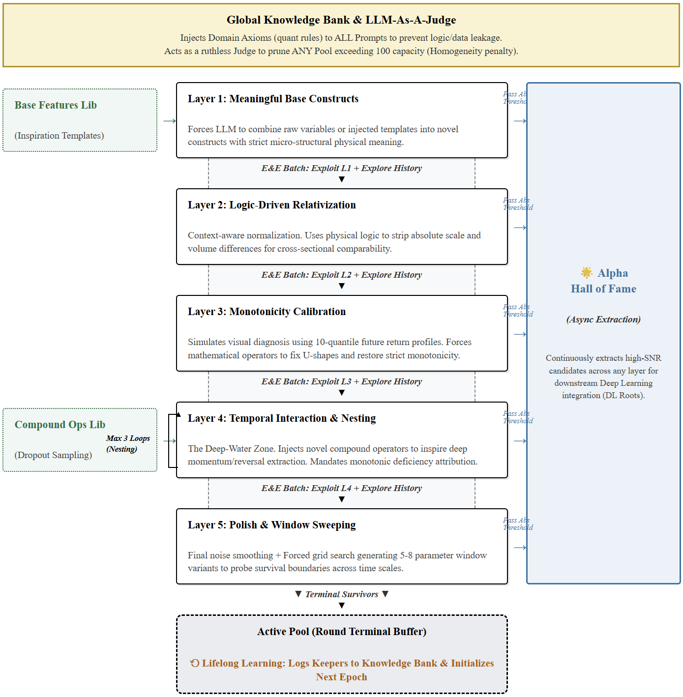

# 🧬 LLM-GA & High-Frequency Futures Alpha Engine / 大模型高频微观因子挖掘与极速计算系统

**[EN]** An end-to-end, dual-phase ultra-high-frequency quantitative feature discovery and execution pipeline. It synergizes the logical reasoning of Large Language Models (LLMs) with two distinct high-performance computational backends: a C++ Symbolic Tracing engine for Tick-to-Minute aggregation, and a GPU-accelerated AST-driven DAG compiler for minute-level Alpha evolution.

**[CN]** 本项目是一个从原始快照数据到可以通过模拟交易系统回测的交易信号的高/中频量化特征挖掘与执行流水线。系统具备**两阶段双引擎架构**：底层利用 C++ 符号追踪引擎与 RAG 智能体，将 500ms 快照设计复杂的降维算法得到微观特征（基础字段）；上层利用 GPU 极速编译引擎与多轮运行的 5 层遗传演化大模型，挖掘深层 Alpha。最后搭载了基于图网络的分层特征去冗余等针对特定目标品种池的筛选、专业的特征评价看板，模型训练（仅展示树模型）以及 NautilusTrader 仿真回测环境。

> ⚠️ **Disclaimer / 特别声明**
> * **[EN]** This repository serves strictly as a replication and showcase of past quantitative research methodologies. It is **not** plug-and-play out of the box due to strict dependencies on proprietary institutional data interfaces. Furthermore, certain core proprietary libraries (e.g., specific foundation templates in `base_features`) have been stripped or reduced to bare minimums for demonstration purposes, and as a replication effort, some useful technical nuances and optimizations from the original system have not yet been fully added in.
> * **[CN]** 本仓库仅作为过往量化研究经验与系统架构设计的复现与展示。由于高度依赖特定的底层数据接口，本项目**并非开箱即用**。同时，部分核心底层依赖（如 `base_features` 中的具体基础因子库）已被剥离或仅保留最小化示例，且由于是复现工程，部分曾实现过的实用细节技巧尚未加入其中。
> 

<p align="center">
  
</p>

> 📚 **Documentation Note / 文档指引**
> * **[EN]** For more rich and detailed technical information regarding specific components, please note that **each subfolder in this repository contains its own dedicated and comprehensive `README.md`**.
> * **[CN]** 为了提供更加丰富、硬核的技术细节，**本仓库的每一个子文件夹下都配有专属且详细的 `README.md` 说明文档**，欢迎深入各个模块查阅。

---

## 🔬 Phase 1: Microstructure Aggregation (500ms ➔ 1-Min) / 阶段一：微观快照降频系统

### 1.1 C++ Symbolic Tracing Engine / C++ 零拷贝符号追踪底座
Designed to process ultra-high-frequency Level-2 snapshot data into minute-level aggregated features. / 专为处理 500ms L2 快照设计的高频聚合底座。

*   **Zero-Copy Memory & C++ Native Execution**: Massive Tick data is loaded via Python (NumPy), but PyBind11 simply passes raw memory pointers to the C++ engine. Iterations bypass the Python GIL completely. (Python 仅做“指挥官”，C++ 闭环遍历数百万行 Tick，绕过 GIL 锁实现绝对零拷贝)。
*   **Symbolic Tracing Graph**: Python acts as a blueprint drawer (`ce.IfElse`, `ce.ConstNode`). The C++ engine dynamically allocates memory and processes the data pipeline based on this DAG. (Python 端仅作“画图连线”，底层 C++ 引擎据此动态构建状态算子流水线)。

### 1.2 Autonomous RAG Agent / RAG 微观逻辑智能挖掘体
Bridges the gap between natural language economic intuition and ultra-high-frequency C++ execution. / 打通“自然语言微观直觉”到“极高频 C++ 算子落地”的次元壁。

*   **Dual-Payload Semantic Retrieval**: Queries the local RAG Vector Database using only the *economic mechanism* to avoid code syntax noise and historical pitfalls. (仅对自然语言假设进行 Embedding，精准避开历史微观结构噪音天坑)。
*   **Economic Intuition (灵魂三问)**: Forces the LLM to articulate: What drives returns? Who is the loser? Why it persists? (强制大模型思考：赚谁的钱？对手盘为何亏损？异象为何持续？)。

### 1.3 Core Base Fields: Active Buy/Sell Decomposition / 核心底层数据 (Base Fields)：主动买卖意愿精细分解
**[EN]** Highlight: The **Active Buy/Sell Decomposition** base fields. Instead of naively relying on order book volumes (which are easily spoofed), the system derives fundamental physics of the order book by computing the instantaneous Tick VWAP and comparing it against the top-of-book quotes and Mid-Price. This non-linear slicing cleanly separates pure aggressive sweeps from passive matching, serving as a highly reliable foundational feature.
**[CN]** 成果展示：系统内置了顶级的**主动买卖意愿分解基础字段 (Base Fields)**。摒弃了容易被撤单操纵的原始盘口挂单量，精准计算瞬间 Tick VWAP，并将其与买一/卖一价及中间价的偏离度进行非线性切割。极度精准地剥离出“纯粹主动扫单”与“被动成交”，真实还原主力机构的微观方向性意图，作为后续演化最坚实的物理底座。

---

## 🚀 Phase 2: Alpha Evolution (1-Min ➔ Deep Alpha) / 阶段二：分钟频高阶演化系统

### 2.1 GPU-Accelerated DAG Compiler / GPU 常驻显存编译引擎
An ultra-low latency, highly scalable GPU subsystem designed for complex minute-level feature engineering. / 专为分钟频高阶特征组合设计的 GPU 极速算力底座。

*   **AST-Driven Compilation & CSE**: Utilizes a Python AST `NodeTransformer` to parse formulas. Enforces Common Subexpression Elimination (CSE). (基于抽象语法树的 DAG 编译，全局公共子表达式消除，极致压缩计算图)。
*   **Zero-IO Formula Chunking**: Entire panels are pinned in GPU VRAM (Pin Memory). Formulas are dispatched in batches, transforming the GPU into a pure execution state. (常驻显存的列式切分，彻底消灭 CPU-GPU 间的 PCIe 数据搬运损耗)。

### 2.2 The 5-Layer Genetic Pipeline / 5层定向基因突变架构
Instead of blind formula generation, the LLM progresses through a strictly scaffolded pipeline: / 系统禁止大模型一口气写完逻辑，将其拆解为 5 道靶向流水线：

*   **[L1] Raw Ingredients**: Injects foundation templates. (注入基础特征模板)。
*   **[L2] Relativization**: Eliminates absolute price/volume scale differences. (强制施加规模剥离，保证截面可比性)。
*   **[L3] Distribution**: Feeds 10-quantile return profiles to correct anomalies mathematically. (向 LLM 喂入分位数表现，强制修复非线性重塑单调性)。
*   **[L4] Temporal Interaction**: Injects compound operators for deep-nested recursion. (注入高阶复合算子启发 LLM 自创深度嵌套)。
*   **[L5] Smoothing & Sweeping**: Enforces exponential smoothing and window grid sweeping. (强制降噪并衍生多时间窗口探索存活边界)。

---

## 🕸️ Phase 3: Graph-Based Feature Selection / 阶段三：基于图网络的特征正交与分层初筛

Before feeding features into complex machine learning models, the system employs rigorous network theory and a hierarchical voting mechanism to deduplicate and extract orthogonal Alphas (`select_feature.py`). / 在进入树模型前，利用图网络与分层投票机制进行严格的因子正交去重与可用性初筛。

*   **Hierarchical Community Discovery & Voting (社区发现与分层投票筛选)**:
    1. **Single-Instrument Pre-selection**: Within each highly-collinear feature community (extracted via Greedy Modularity), the system pre-selects the best performing feature for *each individual instrument* based on historical metrics. (单品种社区内预选：在每个高内聚的共线性特征社区内，首先针对单个品种，依据历史指标挑选出最优特征)。
    2. **Target Pool Coverage Retention**: A community is only retained if it provides valid Alpha for a sufficient ratio (e.g., 20%) of the entire target pool. (全池覆盖率保留：如果某个社区选出的特征无法覆盖目标品种池中足够比例的品种，该特征社区将被整体淘汰)。
    3. **Intra-Community Voting & Tie-breaking**: Features receive "votes" from different instruments within the community. Ties are broken using a globally computed **Pooled IC**, ensuring the final selected representative is the most universally robust Alpha across the entire asset universe. (社区内投票与终选比较：统计社区内各特征获得的“品种选票”。平局时，利用全市场严格洗膜后的 **Pooled IC** 进行绝对值对比决出胜者，确保每个正交社区只保留唯一的、普适性最强的超级特征)。
*   **Strict Tradability Masking (严苛的可交易池屏蔽)**: Evaluates Pooled IC strictly on clean, tradable samples—masking out End-of-Day (EOD) closures, illiquid night sessions, and contract rollover periods, preventing illusory performance. (在计算混池 Pooled IC 时，强制施加极其严格的时空掩码——精准剔除尾盘、长假前夜盘以及换月跳空期，只在“绝对安全可交易”的净样本中验证预测力)。

---

## 🔍 Phase 4: High-Resolution Evaluation & Dashboard / 阶段四：高分辨率特征评价与看板

To strictly prevent look-ahead bias, we built a robust multiprocessed evaluation suite (`feature_quality.py`). / 为严格防止未来函数泄露，设计了极速多进程评估引擎。

*   **Period IC (2000-minute window)**: Replaced traditional Daily IC to perfectly align with a 2000-minute non-overlapping evaluation window. (采用 2000 分钟无重叠评价窗口，确保跨品种统计稳健性)。
*   **Decile Return Spreads (Q10 - Q1)**: Automatically buckets features into 10 quantiles to track monotonicity. (自动划分为 10 组追踪单调性与多空收益差)。
*   **AlphaMiner Pro Dashboard**: An interactive Streamlit app (`dashboard_app.py`) providing Feature-Centric Drilldowns and Scope-Centric Rankings. (交互式看板，支持单特征下钻与全市场横向阈值排行榜)。

---

## 📈 Phase 5: Position Mapping & Backtesting / 阶段五：仓位映射哲学与仿真回测

In `tree_models.py`, we implemented a robust **"2x2 Orthogonal Matrix"** of mapping strategies to handle low signal-to-noise ratio (SNR) environments without data leakage. / 在树模型回测器中，实现了一个“2×2 正交矩阵式”映射策略，防泄露且抗低信噪比。

#### Dimension 1: The Reference Timeframe (时间基准维度)
*   **Real-time Rolling Windows (实时长窗口滚动)**: Dynamically calculates distribution statistics over a long lookback period to adapt to regime shifts. (长回看窗口动态计算分布，自适应市场状态漂移)。
*   **In-Sample (IS) Static Anchoring (样本内静态锚定)**: Extracts exact quantiles/stats directly from IS training folds and carries them forward rigidly into the OOS period, eliminating dynamic-window turnover and look-ahead bias. (从样本内提取确切统计量作为绝对常数应用到样本外，彻底杜绝滚动换手与未来函数)。

#### Dimension 2: The Scaling Mathematics (数学缩放维度)
*   **Z-Score Mapping (Demeaned vs. No-Demean)**: Standard deviation scaling. *Demeaned* captures relative momentum; *No-Demean* preserves absolute directional drift. (Z-Score 映射。减均值捕捉相对动量；不减均值保留原始绝对方向漂移)。
*   **Robust Extremum / Quantile Lock**: Utilizes IQR or fixed hard-quantiles to neutralize extreme outliers and restrict trading to high-conviction zones. (使用 IQR 或固定硬分位数缩放，完美免疫极端异常值，限制在高确信度区间交易)。

> **Advanced Simulation**: The execution engine feeds these signals into a highly rigorous **Memory-Safe Daily Sandbox NautilusTrader Engine**, handling Dynamic Event (hourglass) execution and Continuous Fixed-Grid add-on behaviors with realistic slippage matching. (最终信号喂入极度严苛的 NautilusTrader 每日独立沙盒，支持动态沙漏与固定网格追加追价，完美缝合日频净值曲线)。

---

## 🛠️ Quick Start / 快速启动指南

### 1. Phase 1: Microstructure Tick Mining (500ms ➔ 1Min)
```bash
# Compile the C++ DAG Engine
./build.sh

# Run the RAG Agent to mine new C++ operators using natural language
python miner_agent.py

# Process L2 snapshots into minute-frequency Base Panel features
nohup python run.py > run_tick.log 2>&1 &