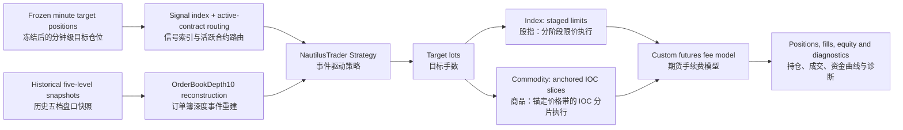

# Event-Driven Futures Execution Simulation / 期货事件驱动执行仿真

## Executive Summary / 模块摘要

**[EN]** This directory is the final simulation layer of the research pipeline. It reads minute-level target positions generated and frozen upstream, reconstructs historical Chinese-futures Level-2 snapshots as NautilusTrader order-book events, and tests how those targets interact with contract routing, trading sessions, order state, visible liquidity, margin, and fees.

**[CN]** 本目录是整套研究流水线的最终仿真层。它读取上游已经生成并冻结的分钟级目标仓位，将中国期货历史 Level-2 快照重建为 NautilusTrader 订单簿事件，再检验这些目标仓位在主力合约路由、交易时段、订单状态、可见流动性、保证金与手续费约束下会如何执行。

The distinction is deliberate: a vectorized factor backtest asks whether a signal contains economic information under a simplified return-and-cost convention; this module asks whether the resulting target position can be translated into an explicit sequence of orders and fills. / 这里刻意区分了两个研究问题：向量化因子回测回答信号在简化收益与费用口径下是否包含经济信息；本模块则回答由此得到的目标仓位能否被转化为明确的订单与成交序列。

---

## Why NautilusTrader / 为什么使用 NautilusTrader

This module is built on the open-source [NautilusTrader](https://github.com/nautechsystems/nautilus_trader) project and its low-level Python `BacktestEngine` API. NautilusTrader provides a deterministic event-driven runtime, typed instruments and orders, simulated venues, order-book replay, positions, accounts, and pluggable fee models. Its official documentation describes the same common event-driven architecture across research simulation and live execution, while also stressing that live trading introduces behavior that a simulation cannot reproduce. / 本模块直接使用开源项目 [NautilusTrader](https://github.com/nautechsystems/nautilus_trader) 及其 Python 低层 `BacktestEngine` API。NautilusTrader 提供确定性的事件驱动运行时、类型化的合约与订单、仿真交易场所、订单簿重放、持仓账户以及可插拔费率模型。其官方文档强调研究仿真与实盘执行共享事件驱动架构，同时也明确指出实盘仍包含仿真无法完整复现的行为。

The choice is useful for this project because execution logic can be expressed through actual strategy callbacks—such as `on_order_book_depth`, `on_order_filled`, and `on_order_expired`—instead of being approximated by a single turnover-cost deduction after the fact. Historical snapshots are replayed into an `L2_MBP` venue, which is the NautilusTrader book type for aggregated market-by-price depth. / 这一选择适合本项目，是因为执行逻辑可以通过 `on_order_book_depth`、`on_order_filled`、`on_order_expired` 等真实策略回调表达，而不是在回测结束后统一扣除一个换手成本。历史快照被送入 `L2_MBP` 场所，即 NautilusTrader 用于聚合价位深度的二级市场深度订单簿类型。

Useful upstream references / 官方参考：

- [NautilusTrader repository and license](https://github.com/nautechsystems/nautilus_trader) / NautilusTrader 仓库与许可证
- [Backtest data and venue semantics](https://nautilustrader.io/docs/latest/concepts/backtesting/data-and-venues/) / 回测数据与场所语义
- [Backtest execution flow](https://nautilustrader.io/docs/latest/concepts/backtesting/execution-flow/) / 回测事件与执行顺序
- [Fill prices, depth walking, and liquidity consumption](https://nautilustrader.io/docs/latest/concepts/backtesting/fill-prices-and-matching/) / 成交价格、盘口逐档成交与可见数量消耗
- [Fill models and their book-type scope](https://nautilustrader.io/docs/latest/concepts/backtesting/fill-models/) / 成交模型及其适用的订单簿类型
- [Trade-driven execution and queue-position requirements](https://nautilustrader.io/docs/latest/concepts/backtesting/trade-execution/) / 逐笔成交驱动与队列位置模型的数据要求
- [Order-book depth model](https://nautilustrader.io/docs/latest/concepts/data/order_book_depth/) / 订单簿深度数据模型

NautilusTrader is under active development. This repository currently does not pin its version, so reproduction should use a release compatible with the imports and `OrderBookDepth10` interface used by these scripts rather than assuming that every upstream version has the same Python API. / NautilusTrader 仍在持续迭代，本仓库目前没有锁定其版本。因此复现时应选择与脚本现有 import 路径及 `OrderBookDepth10` 接口兼容的版本，不能假设上游所有版本的 Python API 完全一致。

---

## Research Flow / 研究流程



The upstream model-output mapping remains visible in the signal columns (`tw_zscore`, `tw_robust`, or `tw_quantile`). This layer does not re-estimate mapping parameters from the backtest period; it selects one already-computed target-weight column through `MAPPING_TYPE`. / 上游的模型输出映射结果以 `tw_zscore`、`tw_robust` 或 `tw_quantile` 信号列传入。本层不会利用回测期数据重新估计映射参数，而是通过 `MAPPING_TYPE` 选择一个已经计算完成的目标权重列。

---

## Files / 文件说明

| File / 文件 | Role / 作用 |
|---|---|
| [`train_and_backtest_index.py`](./train_and_backtest_index.py) | Replays CFFEX index-futures depth for IF, IH, IC, and IM in one continuous NautilusTrader engine. / 在同一个连续 NautilusTrader 引擎中重放 IF、IH、IC、IM 股指期货盘口。 |
| [`train_and_backtest_commodity.py`](./train_and_backtest_commodity.py) | Replays configurable commodity pools across SHFE, DCE, CZCE, INE, and GFEX using one memory-bounded engine sandbox per official trading day, then stitches daily equity. / 对上期所、大商所、郑商所、能源中心与广期所的可配置商品池，按官方交易日建立独立的低内存引擎沙盒，并逐日拼接资金曲线。 |

Both scripts consume the same upstream signal-artifact contract: the model output has already been mapped into a target-weight column before it enters this directory. / 两个脚本使用相同的上游信号文件契约：模型输出在进入本目录前已经映射为目标权重列。

---

## Input Contract / 输入数据契约

### Target-position Parquet / 目标仓位 Parquet

The required columns are: / 必需字段为：

| Column / 字段 | Meaning / 含义 |
|---|---|
| `index_time` | Minute timestamp used to align the frozen target with market events. / 用于将冻结目标仓位与市场事件对齐的分钟时间戳。 |
| `instrument` | Research-level product code, such as `IF` or `RB`. / 研究层品种代码，例如 `IF` 或 `RB`。 |
| `futures_code` | Tradable contract code for that observation, such as a dated main contract. / 该时点对应的可交易合约代码，例如带月份的主力合约。 |
| `tw_zscore`, `tw_robust`, or `tw_quantile` | Target weight selected by `MAPPING_TYPE`. The research contract expects a value in `[-1, 1]`; the loader checks presence but does not clip the value. / 由 `MAPPING_TYPE` 选择的目标权重。研究约定期望取值位于 `[-1, 1]`，但加载器只检查字段是否存在，并不会主动截断。 |

Signals are indexed by `(instrument, calendar date, minute-of-day)`. If the exact minute is absent, the strategy searches backward by at most five calendar minutes within the same date. This is an explicit stale-signal tolerance, not interpolation. / 信号按 `(instrument, calendar date, minute-of-day)` 建立索引。如果当前分钟没有信号，策略最多在同一自然日内向前回看五个日历分钟；这是显式的旧信号容忍规则，而不是插值。

The active contract is taken from `futures_code` in the signal artifact. Contract switching is therefore an upstream routing decision carried into the execution simulation, not reconstructed from volume or open interest inside this directory. / 活跃合约直接来自信号文件中的 `futures_code`。因此，换月属于上游已经确定并传递到执行仿真的路由决定，本目录不会再根据成交量或持仓量重新判断主力合约。

### Historical snapshot CSV / 历史盘口 CSV

The loaders normalize contract codes to uppercase and expand three-digit year-month codes into the repository's four-digit convention. Vendor bid/ask columns are renamed and converted into five valid `BookOrder` levels per side. Because the script uses the fixed-width `OrderBookDepth10` interface, levels 6–10 are padded with zero-priced, zero-sized orders with the correct BUY/SELL side. / 加载器会把合约代码统一为大写，并将三位年月代码补齐为本仓库使用的四位格式。供应商买卖盘字段被重命名并转换为每侧五档有效 `BookOrder`。由于脚本使用固定宽度的 `OrderBookDepth10` 接口，第 6–10 档使用价格和数量均为零、且买卖方向正确的订单补齐。

Each snapshot timestamp is converted from China Standard Time to UNIX nanoseconds before being added to NautilusTrader. Instrument expiration for simulation registration is inferred from the last available snapshot timestamp, with the final signal timestamp as a fallback. This value is a data-availability boundary for the simulation; it should not be interpreted as the exchange's legal delivery or expiry calendar. / 每条快照时间会按中国标准时间转换为 UNIX 纳秒时间，再注入 NautilusTrader。仿真注册所需的合约到期时间由该合约最后一条可用快照推导，并以最后一条信号时间作为兜底。这个值表示本次仿真的数据可用边界，不应被解释为交易所法定交割或到期日历。

---

## From Target Weight to Orders / 从目标权重到订单

### Position sizing / 手数换算

For each active contract, the current top-of-book midpoint determines contract notional:

```text
contract_notional = mid_price × contract_multiplier
max_lots          = floor(MAX_WEIGHT_PER_INST × allocated_capital / contract_notional)
target_lots       = round(target_weight × max_lots)
order_delta       = target_lots - current_signed_lots
```

每个活跃合约使用当前盘口中间价计算合约名义价值，再根据分配资金、单品种最大权重和合约乘数换算整数目标手数，最终只针对目标手数与当前有符号持仓之间的差额发单。

The implementation uses `max(1, max_lots)`, so a contract whose single-lot notional exceeds the allocated capital can still receive one lot when the target is large enough. This is a practical discreteness choice and should be reviewed when comparing products with very different contract notionals. / 实现中使用了 `max(1, max_lots)`，因此当单手名义价值高于分配资金时，只要目标权重足够大，仍可能得到一手目标仓位。这是处理离散手数的工程选择，在比较合约名义价值差异很大的品种时需要单独审视。

### Two signal-timing regimes / 两种信号调度机制

**Fixed 30-minute grid (`zscore` and `robust`) / 固定 30 分钟网格：**

- At the first eligible minute of each 30-minute slot, the strategy replaces the previous target with the current target. / 每个 30 分钟窗格的第一个有效分钟，策略使用当前目标替换上一窗格目标。
- During the configured five-minute add-on window, it only adds exposure when the signal makes a more extreme move in the existing direction. A weaker same-direction signal does not mechanically reduce the position inside that add-on window. / 在配置的五分钟追加窗口内，只有信号沿当前方向创出更极端值时才追加仓位；同方向但变弱的信号不会在追加窗口内机械减仓。
- The timing rule is shared, but execution is market-specific: the index strategy may keep concurrent staged-limit add-ons, while the commodity strategy replaces any stale IOC child order and recomputes the required quantity from the actually filled position. / 两类脚本共享同一追加时点规则，但执行方式不同：股指策略允许分阶段限价追加单并行存在；商品策略会替换已经过时的 IOC 子订单，并根据真实已成交持仓重新计算所需数量。

**Dynamic 30-trading-minute window (`quantile`) / 动态 30 个交易分钟窗口：**

- A non-zero signal opens an event window whose clock advances only through valid trading minutes. / 非零信号触发一个事件窗口，其计时只在有效交易分钟内推进。
- Signal updates can revise the target during the active window; reversals cancel outstanding orders and recompute the delta from the current filled position. / 窗口存续期间信号变化可以更新目标；方向反转时会撤销未完成订单，并根据当前已成交持仓重新计算差额。
- A zero signal cancels outstanding execution intent but keeps already filled lots until the window expires; at expiry, a zero signal closes the position, while a non-zero signal rolls into a new window. / 信号归零时撤销尚未完成的执行意图，但已经成交的持仓会保留到窗口到期；到期时若信号仍为零则平仓，否则滚动进入新的事件窗口。

### Index: three-stage limit-order execution / 股指：三阶段限价单执行

1. **Stage 1 — passive attempt / 第一阶段：被动挂单。** A BUY starts at the best bid and a SELL starts at the best ask, using GTD with a 45-second lifetime. If visible same-side top-level quantity is below `MIN_BEST_QTY`, the order starts directly at the opposite best quote as a marketable limit. / 买单先挂买一、卖单先挂卖一，并使用 45 秒有效期的 GTD；如果同侧一档可见数量低于 `MIN_BEST_QTY`，则直接改用对手方最优价形成可成交限价单。
2. **Stage 2 — reprice / 第二阶段：追价。** If the book moves away before expiry, or Stage 1 expires with remaining quantity, the remainder is canceled and reissued at the opposite best quote for another 45 seconds. / 如果盘口在到期前向不利方向移动，或者第一阶段到期后仍有剩余数量，则撤销剩余量，并在对手方最优价重新提交一个 45 秒 GTD 订单。
3. **Stage 3 — persistent remainder / 第三阶段：保留剩余单。** If Stage 2 expires, the remaining quantity is reissued at the current opposite best quote as GTC. / 如果第二阶段仍然到期，剩余数量会按当时对手方最优价改为 GTC 订单。

The index order tracker is keyed by instrument and client-order ID, so concurrent add-on orders can retain separate phase and remaining-quantity state. Partial fills are read from the live order before the next stage is submitted. / 股指订单追踪以合约和客户端订单 ID 为键，因此并发追加单可以分别保留阶段与剩余数量状态；进入下一阶段前会从实时订单状态中扣除已经部分成交的数量。

### Commodity: anchored, repeated IOC taking / 商品：锚定首个对手价后重复 IOC 吃单

Commodity execution deliberately uses a different policy. A minute signal is treated as available at the exact minute boundary; the strategy ignores the `.000s` snapshot and evaluates it on the first snapshot at or after `.500s`. At that moment it fixes an execution anchor: a BUY uses that snapshot's best ask and a SELL uses its best bid. The worst permitted price is exactly one instrument tick beyond that opposite quote. / 商品执行刻意采用另一套策略。分钟信号被视为在整分边界完成；策略忽略 `.000s` 快照，在该分钟第一条不早于 `.500s` 的快照上读取信号。此时固定本轮执行锚点：买入取该快照卖一，卖出取该快照买一；允许的最差价格仅为该对手价再向不利方向一 Tick。

For every eligible 500 ms snapshot, the strategy submits a marketable `LIMIT IOC` for the difference between the target lots and the actually filled position. NautilusTrader may consume displayed liquidity at the anchored opposite quote and at most the one-tick-deeper price; the IOC remainder is canceled rather than walking through all five levels. The target itself remains active, so the next snapshot can supply refreshed displayed liquidity and trigger another IOC attempt. Execution stops only when the filled position reaches the target or a newer signal replaces the target and its anchor. / 对每一条可执行的 500 ms 快照，策略都针对“目标手数减真实已成交持仓”的剩余差额提交可成交的 `LIMIT IOC`。NautilusTrader 只能使用锚定对手价以及最多再深一 Tick 的显示流动性；未成交余量由 IOC 当即撤销，不会继续穿透全部五档。但目标本身仍然保留，因此下一张快照展示出的新流动性可以触发下一次 IOC，直至真实持仓达到目标，或者新信号替换目标及其价格锚点。

Commodity venues enable `liquidity_consumption=True`, so displayed quantity cannot be reused repeatedly within the same matching state. A fresh historical snapshot refreshes the recorded quantities and is treated as the next observable opportunity for liquidity replenishment. This combines NautilusTrader's native L2 price-and-size matching, IOC remainder cancellation, and per-level consumption tracking. The generic `prob_slippage` switch is not added because NautilusTrader applies it only to `L1_MBP`; the synthetic one-tick and tiered fill models are also not used because they replace the observed snapshot depth with a synthetic book. / 商品场所启用 `liquidity_consumption=True`，同一撮合状态下的显示数量不会被反复使用；新的历史快照会刷新记录数量，并被视为下一次可观察的补单机会。这里组合使用 NautilusTrader 原生的 L2 价量撮合、IOC 余量撤销和逐价位流动性消耗跟踪。没有额外设置通用 `prob_slippage`，因为 NautilusTrader 只在 `L1_MBP` 下应用它；也不使用合成的一 Tick 或分层 FillModel，因为它们会用人工盘口替换实际快照深度。

Only aggregated price-level snapshots are supplied. NautilusTrader's queue-position model requires book data together with `TradeTick` execution evidence; this path supplies no `TradeTick` stream and does not enable that model. The simulation therefore makes no claim about same-price execution priority. / 输入只有按价位聚合的盘口快照。NautilusTrader 的队列位置模型需要盘口与 `TradeTick` 成交证据共同驱动；本路径既没有注入 `TradeTick`，也没有启用该模型，因此仿真不对同价位成交优先级作任何假设。

---

## Index and Commodity Implementations / 股指与商品脚本的差异

| Dimension / 维度 | Index futures / 股指期货 | Commodity futures / 商品期货 |
|---|---|---|
| Default universe / 默认池 | IF, IH, IC, IM | Configurable pools; current default is `ferrous` (`RB`, `HC`, `I`, `J`, `JM`, `SM`, `SF`). / 可配置品种池；当前默认是黑色池。 |
| Engine lifecycle / 引擎生命周期 | One continuous engine across all signal dates. / 全部信号日期共用一个连续引擎。 | One independent engine per official `trd_day`, disposed after settlement; daily equity is stitched outside the engine. / 每个官方 `trd_day` 使用独立引擎，结算后释放，再在引擎外拼接日度资金曲线。 |
| Account structure / 账户结构 | One CFFEX margin account initialized with CNY 10 million. Each product's sizing formula references the same capital base. / 一个初始资金 1000 万元的中金所保证金账户，各品种手数换算引用同一资金基数。 | Initial portfolio capital is CNY 10 million per configured product. Daily pool equity is equally reassigned across products, and each exchange account receives the sum of its products' allocations. / 初始组合按每个配置品种 1000 万元计；每天将组合净值等额分配给各品种，各交易所账户获得所属品种份额之和。 |
| Trading-day interpretation / 交易日口径 | Calendar-day routing is sufficient because the selected index contracts have no night session in this dataset. / 所选股指合约没有夜盘，因此使用自然日路由。 | Day and night files are grouped by their recorded `trd_day`; timestamps at or after 21:00 are assigned to the following session day so the night session is not reset at midnight. / 日盘与夜盘文件按记录的 `trd_day` 归组，21:00 以后事件归属于下一交易时段日，跨午夜不会重置状态。 |
| Session filters / 时段过滤 | Strategy decisions are evaluated from 09:31 until the forced-flat boundary. Dynamic-window time skips the midday break. / 从 09:31 起评估策略，到强制平仓边界为止；动态窗口计时跳过午休。 | Uses product-specific night-session closing times plus 09:01–10:15, 10:30–11:30, and 13:30–15:00 day sessions; the opening minute of each session segment is skipped for decision making. / 使用品种特定夜盘收盘时间，以及 09:01–10:15、10:30–11:30、13:30–15:00 日盘区间；各时段开盘首分钟不用于决策。 |
| Order execution / 订单执行 | Three-stage LIMIT execution: passive GTD, marketable GTD repricing, then a persistent GTC remainder. / 三阶段限价执行：被动 GTD、对手价 GTD 追价、最终 GTC 保留剩余单。 | At the first snapshot at or after 500 ms, anchors the opposite quote and caps execution one tick deeper; each later snapshot submits a LIMIT IOC for the remaining target delta. / 在第一条不早于 500 ms 的快照锚定对手价，并把执行上限设为再深一 Tick；后续每张快照对剩余目标差额提交 LIMIT IOC。 |
| Forced flat / 强制平仓 | On the first active-contract snapshot at or after 14:30, outstanding orders are canceled and the position is targeted to zero. / 14:30 及以后第一条活跃合约快照到来时，撤销未完成订单并把目标仓位设为零。 | Uses the same afternoon flat rule. Before a weekend, holiday gap, or the last available signal day, it also targets zero during the final 30 minutes before that product's night close. / 同样执行午后平仓；在周末、节假日间隔或最后一个可用信号日前，还会在该品种夜盘收盘前最后 30 分钟平仓。 |
| Fee model / 费率模型 | `CffexIndexFeeModel` distinguishes open/close-yesterday from the higher close-today rate using position state. / 根据持仓状态区分开仓/平昨与较高的平今费率。 | `UniversalFuturesFeeModel` supports fixed CNY-per-lot and notional-ratio fees, splits each fill into open, close-yesterday, and close-today quantities, and handles configured intraday-open adjustments. / 同时支持按手固定金额和按成交额比例收费，将成交拆为开仓、平昨、平今，并处理配置的日内开仓补差。 |

The commodity session calendar is intentionally product-specific. Products absent from `NIGHT_CLOSE_MINS` are treated as having no night session rather than being forced into one universal 02:30 calendar. / 商品时段表刻意按品种区分；未出现在 `NIGHT_CLOSE_MINS` 中的品种被视为没有夜盘，而不是统一套用 02:30 收盘假设。

---

## Performance Outputs / 结果输出

The index script reports end positions, account balances, and counts of filled, expired, and canceled orders across the continuous run. / 股指脚本输出连续回测结束后的持仓、账户余额，以及成交、到期和撤单数量。

The commodity script additionally maintains: / 商品脚本还会维护：

- per-instrument realized gross PnL, commission, volume, order count, fill rate, active days, and winning days; / 分品种已实现毛盈亏、手续费、成交手数、订单数、成交率、交易天数与盈利天数；
- a daily stitched portfolio-equity series beginning from the explicit initial capital; / 从明确初始资金出发拼接的日度组合资金曲线；
- cumulative and annualized return, annualized daily volatility, Sharpe, maximum drawdown, Calmar, and daily win rate; / 累计收益、年化收益、日度年化波动率、Sharpe、最大回撤、Calmar 与日度胜率；
- aggregate order-state diagnostics and total processed snapshot count. / 汇总订单状态诊断与处理的快照总数。

The first trading-day return is computed against the inserted initial-capital observation, and every later daily return uses the previous day's stitched equity as its denominator. / 第一交易日收益以显式插入的初始资金为基准，此后每天都以前一日拼接净值作为收益率分母。

---

## Running the Scripts / 运行方式

Run from the repository root after installing an API-compatible NautilusTrader build and the tabular-data dependencies used by the project. The examples assume that the snapshot directory layout and signal files described above are available locally. / 安装与当前代码 API 兼容的 NautilusTrader 版本及项目所需表格数据依赖后，从仓库根目录运行。以下示例假设本地已经存在前述盘口目录结构与信号文件。

```powershell
python run_backtest/train_and_backtest_index.py
python run_backtest/train_and_backtest_index.py --signals=D:\path\to\oos_signals_index.parquet

python run_backtest/train_and_backtest_commodity.py
python run_backtest/train_and_backtest_commodity.py `
  --signals=D:\path\to\oos_signals_ferrous.parquet `
  --start-date=20251024 `
  --end-date=20251231
```

`POOL_NAME`, `MAPPING_TYPE`, capital, add-on window, instrument specifications, snapshot roots, and the index strategy's order lifetimes and depth threshold are currently source-level configuration rather than command-line options. / `POOL_NAME`、`MAPPING_TYPE`、资金、追加窗口、合约规格、快照根目录，以及股指策略的订单有效期与深度阈值，目前都是源码级配置，并非命令行参数。

The index script currently parses `--date` but does not pass it into its data-loading or engine functions, so `--date` should not be interpreted as an effective date filter. For the commodity script, use the explicit `--start-date` and `--end-date` pair when a bounded range is required. / 股指脚本目前虽然解析了 `--date`，但没有将其传入数据加载或引擎函数，因此不能把 `--date` 理解为有效的日期过滤器。商品脚本如果需要明确区间，应使用 `--start-date` 与 `--end-date` 组合。

---

## Interpretation and Simulation Boundaries / 结果解释与仿真边界

### What this layer improves / 这一层增加了什么

- It replays frozen target positions through explicit market-data, order, fill, position, account, and fee events. / 将冻结后的目标仓位放入显式的行情、订单、成交、持仓、账户与手续费事件中重放。
- It makes contract multipliers, integer lots, margin accounts, active contracts, session boundaries, and fee semantics explicit. / 显式处理合约乘数、整数手数、保证金账户、活跃合约、交易时段与手续费语义。
- It represents two distinct execution hypotheses: staged limit-order lifecycle and concurrent add-ons for index futures, versus anchored aggressive IOC slices and target completion across replenished snapshots for commodities. / 它分别表达两套执行假设：股指期货的分阶段限价单生命周期与并发追加，以及商品期货在固定价格带内的主动 IOC 切片和跨补单快照目标完成。
- It exposes implementation-sensitive diagnostics—especially fill rate, commissions, and per-product PnL—that are hidden by a one-line turnover penalty. / 暴露简单换手惩罚无法观察的执行诊断，尤其是成交率、手续费与分品种盈亏。

### What it does not prove / 这一层不能证明什么

- **OOS status is inherited from the whole research history.** Reading a file named `oos_signals` does not make it OOS if its period influenced feature discovery, model selection, mapping, or execution tuning. / **样本外属性取决于完整研究历史。** 文件名叫 `oos_signals` 并不能自动证明其样本外性；只要该时期参与过特征挖掘、模型选择、映射或执行参数调优，就不能视为未触碰样本。
- **Five-level snapshots are not a full matching tape.** The source contains aggregated visible depth rather than order-by-order messages, levels 6–10 are padding, and no trade ticks are added as separate execution evidence. / **五档快照不是完整撮合流水。** 数据只有聚合可见深度而非逐订单消息，第 6–10 档只是补位，脚本也没有额外注入逐笔成交作为成交证据。
- **Snapshot replenishment is an explicit approximation.** Commodity IOC slices never pay beyond the initial opposite quote plus one adverse tick, and a fresh 500 ms snapshot may expose new executable quantity. The historical book remains immutable, however, so this does not reproduce hidden liquidity or the market's causal response to our own orders. The 500 ms start delay and one-tick price band are explicit research assumptions, not a calibrated network-latency or endogenous-impact model. / **快照补单是一项显式近似。** 商品 IOC 切片不会成交在首次对手价再向不利方向一 Tick 以外，而新的 500 ms 快照可能展示新的可成交数量；但历史盘口仍不会被仿真订单内生改变，因此无法恢复隐藏流动性或市场对自身订单的因果反应。500 ms 起始延迟与一 Tick 价格带都是显式研究假设，并非经过标定的网络延迟或内生冲击模型。
- **Fee tables are dated assumptions.** The hard-coded 2025 schedules are research inputs, not an evergreen source of exchange truth; they should be versioned and rechecked before interpreting another period. / **手续费表具有年份属性。** 代码中的 2025 费率是研究输入，而不是永久有效的交易所事实；解释其他时期前应重新核验并进行版本化。
- **Fill behavior is model-dependent.** NautilusTrader processes market data, updates the simulated venue, and then dispatches strategy callbacks under its documented event ordering. Results therefore depend on the engine version, book type, and configured matching assumptions as well as on the strategy itself. / **成交结果依赖仿真模型。** NautilusTrader 按其文档规定的事件顺序处理市场数据、更新仿真场所并触发策略回调；因此结果不仅取决于策略，也取决于引擎版本、订单簿类型与撮合假设。

For this reason, the output should be read as an execution-aware research simulation: materially closer to the order process than a vectorized return calculation, but still not a promise of live fill quality or deployable PnL. / 因此，本模块输出应被理解为具备执行意识的研究仿真：它比向量化收益计算更接近真实订单过程，但仍不等于对实盘成交质量或可实现盈亏的承诺。

